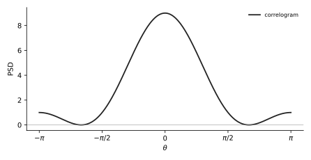

# U11 · Correlogram: from a few autocorrelation lags to a PSD in cosines

Rank 13 · 4.7 points over 7 sittings0.4 to 1 p every exam, pure mechanics35 min

!!! need "Before this page"
    [M3 rule 1](maths.md#m3-complex-exponentials-and-cosine-identities): $re^{jk\theta} + re^{-jk\theta} = 2r\cos k\theta$. That is the whole page.

## The idea in plain words

The **autocorrelation** $r[k]$ says how much a signal resembles itself shifted by $k$ samples. The **power spectral density (PSD)** says how the signal's power is spread over frequency. They are two views of the same thing: the PSD is the Fourier transform of the autocorrelation. The **correlogram** is simply that transform computed from the few lags you were given, treating all other lags as zero.

!!! idea "The thing that confused me"
    The sum runs over negative and positive $k$, but the exam only gives $r[0], r[1], r[2]$. Autocorrelation is symmetric, $r[-k] = r[k]$, so each positive lag appears twice (once as $e^{-jk\theta}$, once as $e^{+jk\theta}$) and the pair collapses to $2r[k]\cos k\theta$. The lag $0$ appears once.

## A tiny example with numbers

$r[0] = 1$, $r[\pm1] = 0.5$, everything else zero.
$P(e^{j\theta}) = r[0] + r[1]e^{-j\theta} + r[-1]e^{j\theta} = 1 + 0.5(e^{-j\theta} + e^{j\theta}) = 1 + \cos\theta$.
At $\theta = 0$: $2$. At $\theta = \pm\pi$: $0$. Positive correlation at lag 1 means a smooth signal: power at low frequency.

!!! question "Your turn"
    $r[0] = 1$, $r[\pm1] = -0.5$. PSD? Value at $\theta = 0$ and at $\pi$? What kind of signal is it?

    ???+ solution "Answer"
        $1 - \cos\theta$; $0$ at $\theta=0$, $2$ at $\pi$. Negative lag-1 correlation means the sign flips every sample: a fast, high-frequency signal.

## The formula, every symbol named

$$\hat P_{corr}(e^{j\theta}) = \sum_{k=-M}^{M}r[k]\,e^{-jk\theta} = r[0] + 2\sum_{k=1}^{M}r[k]\cos(k\theta)$$

| Symbol | Meaning |
|---|---|
| $r[k]$ | autocorrelation at lag $k$: $E[x[n]x[n-k]]$; symmetric, $r[-k] = r[k]$; $r[0]$ is the power and is the largest |
| $\theta$ | normalised frequency in radians per sample, from $-\pi$ to $\pi$ ($0$ = DC, $\pi$ = the fastest possible alternation) |
| $M$ | the largest lag you know; the exam says "assume $r[k] = 0$ for $\lvert k\rvert > M$" |
| $e^{-jk\theta}$ | the Fourier kernel; you never evaluate it, you pair it with $e^{+jk\theta}$ into a cosine |

**Where the second form comes from.** Split the sum into $k = 0$, $k>0$ and $k<0$; substitute $k\to-k$ in the last and use $r[-k] = r[k]$: $r[k](e^{-jk\theta} + e^{jk\theta}) = 2r[k]\cos k\theta$ ([M3](maths.md#m3-complex-exponentials-and-cosine-identities)).

## What the exam asks, in its own words

| IF YOU SEE | It means |
|---|---|
| "calculate the non-parametric correlogram estimate … using only the given lags" | plug the lags into $r[0] + 2\sum r[k]\cos k\theta$; nothing else |
| "express it as a function of $\cos(\theta)$ / of cosines" | the answer is $a + b\cos\theta + c\cos2\theta + \ldots$ with numbers $a, b, c$ |
| "use the correlogram method to calculate the PSD" after a model question | first get $r[k]$ from the model ([U14](u14-model-autocorr.md)), then this page |
| "assume $r[k] = 0$ for $\lvert k\rvert > 2$" | sum stops at $M = 2$ |
| "determine and plot" / "sketch in the fundamental range $-\pi\le\theta\le\pi$" | evaluate at $\theta = 0, \pm\pi/2, \pm\pi$ (and where a cosine term peaks), mark those values, draw a symmetric curve |
| "which plot shows the correct PSD" | compute the values at $0$ and $\pm\pi$ and match ([U15](u15-spectral-mc.md)) |

## Recipe

!!! recipe key "U11 · Lags to cosines"
    1. List $r[0], r[1], \ldots, r[M]$ (use the hint "zero beyond $M$").
    2. Write $P = r[0] + 2r[1]\cos\theta + 2r[2]\cos2\theta + \cdots + 2r[M]\cos M\theta$. Double every lag except $0$.
    3. Multiply out the numbers; keep fractions.
    4. Evaluate at $\theta = 0$ ($\cos k\theta = 1$ for all $k$: sum of $r[0] + 2r[1] + 2r[2] + \ldots$) and at $\theta = \pi$ ($\cos k\pi = (-1)^k$: alternate signs). If asked, also $\pm\pi/2$ ($\cos\frac\pi2 = 0$, $\cos\pi = -1$, $\cos\frac{3\pi}{2} = 0$).
    5. Note if the value goes negative somewhere: a true PSD cannot, but a truncated correlogram can; mention it, it is a known flaw of the method.

## Worked exam question, one step at a time

!!! exam "June 2026 resit · 3c · 0.5 p"
    Consider a wide-sense stationary, real-valued random process $x[n]$ whose first three autocorrelation values have been estimated as $r_x[0] = 3$, $r_x[1] = 2$, $r_x[2] = 1$. Calculate the non-parametric correlogram estimate of the power spectral density, $\hat{P}_{Corr}(e^{j\theta})$, using only the given autocorrelation lags. Assume $r_x[k] = 0$ for $|k| > 2$. Derive $\hat{P}_{Corr}(e^{j\theta})$ as a function of $\cos(\theta)$.

**Step 1 · Lags.** $r[0] = 3$, $r[\pm1] = 2$, $r[\pm2] = 1$, zero beyond.

**Now do step 2 yourself:** write the five-term sum with exponentials, then pair them.

---

**Step 2 · Sum and pair.** $\hat P = r[-2]e^{j2\theta} + r[-1]e^{j\theta} + r[0] + r[1]e^{-j\theta} + r[2]e^{-j2\theta} = 3 + 2(e^{j\theta} + e^{-j\theta}) + 1\cdot(e^{j2\theta} + e^{-j2\theta})$. Pairs: $e^{j\theta} + e^{-j\theta} = 2\cos\theta$; $e^{j2\theta} + e^{-j2\theta} = 2\cos2\theta$.

**Now do step 3 yourself:** multiply out.

---

**Step 3 · Numbers.** $\hat P_{corr}(e^{j\theta}) = 3 + 4\cos\theta + 2\cos2\theta$.

**Now do step 4 yourself:** values at $\theta = 0$, $\pi/2$, $\pi$.

---

**Step 4 · Values.** $\theta = 0$: $3 + 4 + 2 = 9$. $\theta = \pi/2$: $\cos\frac\pi2 = 0$, $\cos\pi = -1$: $3 + 0 - 2 = 1$. $\theta = \pi$: $\cos\pi = -1$, $\cos2\pi = 1$: $3 - 4 + 2 = 1$. Between $\pi/2$ and $\pi$ it dips: at $\theta = 2\pi/3$, $\cos = -\frac12$, $\cos2\theta = -\frac12$: $3 - 2 - 1 = 0$. Never negative here. Low-pass shape: strong positive lags → power at low frequency.

<figure markdown>

<figcaption><b>How to read it.</b> Horizontal axis $\theta$ from $-\pi$ to $\pi$. Peak 9 at 0, value 1 at $\pm\pi/2$ and at $\pm\pi$, touching 0 at $\pm2\pi/3$.</figcaption>
</figure>

!!! answer "Answer"
    $\hat P_{corr}(e^{j\theta}) = 3 + 4\cos\theta + 2\cos2\theta$.

## Do it cold · 1

!!! exam "April 2025 · 3d · 0.5 p"
    Autocorrelation at lags $0, \pm1, \pm2$: $r[0] = 2$, $r[\pm1] = -\frac14$, $r[\pm2] = -\frac{3}{16}$. Use the correlogram method to calculate the PSD in a non-parametric fashion. Express $P_{corr}(e^{j\theta})$ as a function of cosines.

???+ solution "Solution"
    $P = 2 + 2\left(-\frac14\right)\cos\theta + 2\left(-\frac{3}{16}\right)\cos2\theta = 2 - \frac12\cos\theta - \frac38\cos2\theta$. At $0$: $2 - 0.5 - 0.375 = 1.125$. At $\pi$: $2 + 0.5 - 0.375 = 2.125$. At $\pi/2$: $2 - 0 + 0.375 = 2.375$. Maximum about $2.46$ near $\theta\approx0.61\pi$ (the official key quotes these numbers). Needed in 3g to pick plot D.

    !!! answer "Answer"
        $P_{corr}(e^{j\theta}) = 2 - \frac12\cos\theta - \frac38\cos2\theta$.

## Do it cold · 2

!!! exam "April 2024 · 3d · 0.4 p"
    (From 3c, the MA(3) signal $x[n] = i[n] - \frac12 i[n-1] + \frac14 i[n-2] - \frac12 i[n-3]$ has $r[0] = \frac{25}{16}$, $r[\pm1] = -\frac34$, $r[\pm2] = \frac12$, $r[\pm3] = -\frac12$; derived in [U14](u14-model-autocorr.md).) Using the correlogram method, give an estimate of the power spectral density. Express it as a function of cosines.

???+ solution "Solution"
    $P = \frac{25}{16} + 2\left(-\frac34\right)\cos\theta + 2\cdot\frac12\cos2\theta + 2\left(-\frac12\right)\cos3\theta = \frac{25}{16} - \frac32\cos\theta + \cos2\theta - \cos3\theta$. At $0$: $1.5625 - 1.5 + 1 - 1 = 0.0625$. At $\pi$ ($\cos\pi = -1$, $\cos2\pi = 1$, $\cos3\pi = -1$): $1.5625 + 1.5 + 1 + 1 = 5.0625$. At $\pi/2$ ($0, -1, 0$): $1.5625 - 1 = 0.5625$. High-pass: almost zero at DC, 5 at $\pi$. That is how you pick plot B in 3f.

    !!! answer "Answer"
        $P_{corr}(e^{j\theta}) = \frac{25}{16} - \frac32\cos\theta + \cos2\theta - \cos3\theta$.

## Do it cold · 3

!!! exam "January 2022 resit · 3c · 1 p"
    MA(2) process $x[n] = i[n] + ai[n-1] + bi[n-2]$, unit-variance white $i[n]$, with $a = -\frac34$, $b = \frac14$ (from 3b) so that $r[\pm1] = -\frac{15}{16}$, $r[\pm2] = \frac14$. Calculate the PSD using the correlogram method. **Hint:** the autocorrelation of a MA process is of finite length.

???+ solution "Solution"
    First $r[0]$ (U14): $r[0] = 1 + a^2 + b^2 = 1 + \frac{9}{16} + \frac1{16} = \frac{26}{16} = \frac{13}{8}$. Then $P = \frac{13}{8} + 2\left(-\frac{15}{16}\right)\cos\theta + 2\cdot\frac14\cos2\theta = \frac{13}{8} - \frac{15}{8}\cos\theta + \frac12\cos2\theta$.

    !!! answer "Answer"
        $P(e^{j\theta}) = \frac{13}{8} - \frac{15}{8}\cos\theta + \frac12\cos2\theta$. (With the fallback values $a = \frac14$, $b = \frac54$: $r[0] = \frac{21}{8}$, $r[1] = a + ab = \frac{9}{16}$, $r[2] = b = \frac54$, $P = \frac{21}{8} + \frac98\cos\theta + \frac52\cos2\theta$.)

## Do it cold · 4

!!! exam "November 2019 · 2a · 1 p"
    $r_x[0] = 1$, $r_x[\pm1] = 0.7$, $r_x[\pm2] = 0.5$, $r_x[\pm3] = 0.3$, $r_x[\pm4] = 0$. Determine and plot the correlogram power spectrum estimate.

???+ solution "Solution"
    $P = 1 + 1.4\cos\theta + 1.0\cos2\theta + 0.6\cos3\theta$. At $0$: $4.0$. At $\pi$: $1 - 1.4 + 1 - 0.6 = 0$. At $\pi/2$: $1 + 0 - 1 + 0 = 0$. Peak 4 at DC, zero at $\pm\pi/2$ and $\pm\pi$, with small bumps in between.

    !!! answer "Answer"
        $P_{corr}(e^{j\theta}) = 1 + 1.4\cos\theta + \cos2\theta + 0.6\cos3\theta$.

## Do it cold · 5 (single lag)

!!! exam "January 2020 retake · 3a · 0.8 p (and October 2021 · 3c · 0.5 p)"
    $r_x[0] = \frac{1}{21}$, $r_x[\pm1] = \frac{2}{105}$, zero else. Determine and plot the correlogram estimate. (Oct 2021 3c: same with $\rho[0] = \frac{28}{27}$, $\rho[\pm1] = -\frac{4}{27}$, treating the signal as MA(1) so only lags $0,\pm1$ count.)

???+ solution "Solution"
    Jan 2020: $P = \frac1{21} + 2\cdot\frac{2}{105}\cos\theta = \frac1{21} + \frac4{105}\cos\theta$. At $0$: $\frac{5}{105} + \frac4{105} = \frac{9}{105} = 0.0857$. At $\pi$: $\frac1{105} = 0.0095$. Oct 2021: $P = \frac{28}{27} - \frac{8}{27}\cos\theta$; $\frac{20}{27} = 0.741$ at $0$, $\frac{36}{27} = 1.333$ at $\pi$.

    !!! answer "Answer"
        $\frac{1}{21} + \frac{4}{105}\cos\theta$ (Jan 2020); $\frac{28}{27} - \frac{8}{27}\cos\theta$ (Oct 2021).

## Where points get lost

!!! trap key "Where points get lost"
    | Wrong line | Right line |
    |---|---|
    | $P = r[0] + r[1]\cos\theta + r[2]\cos2\theta$ | Every lag except 0 is **doubled**: $2r[1]\cos\theta$. |
    | $P = 2r[0] + 2r[1]\cos\theta$ | $r[0]$ appears once. |
    | $\cos2\theta$ evaluated as $2\cos\theta$ at $\theta = \pi$ | $\cos(2\pi) = +1$, $\cos(3\pi) = -1$: alternate signs for the lag-$k$ term at $\pi$. |
    | Leaving $e^{-j\theta}$ in the answer when "as a function of cosines" is demanded | Pair them. Marks are for the cosine form. |
    | Treating a negative value as an arithmetic error | A truncated correlogram can go negative; note it. |

## True or false (from real MC options)

| statement | T or F | why |
|---|---|---|
| The correlogram estimates the power spectrum as the Fourier transform of the autocorrelation function. | True | Apr 2024 3a row 4 (correlogram, Blackman–Tukey). |
| The "raw" periodogram achieves better performance in bias but worse in variance than the "raw" correlogram. | False | Apr 2025 3b (c): the raw periodogram and raw correlogram are the same estimator (periodogram = FT of the biased autocorrelation estimate). |
| The autocorrelation function of an MA model with $Q$ zeros is a finite sequence of length $Q$. | False | Jan 2019 1d (A): nonzero lags are $-Q..Q$, i.e. $2Q+1$ values, $Q+1$ distinct. |
| A legitimate autocorrelation sequence is symmetric with its maximum at lag 0. | True | Jan 2020 1a: the test to pick valid $r[l]$ plots. |

**You can leave this page when you can:**

- [ ] turn three lags into $a + b\cos\theta + c\cos2\theta$ in one line.
- [ ] evaluate it at $0$, $\pi/2$, $\pi$ without a calculator.
- [ ] sketch the curve with those three values and symmetry.

*[autocorrelation]: r[k] = E[x[n] x[n−k]]: the similarity of the signal with a copy shifted by k samples.
*[PSD]: power spectral density: how the power of a random signal is distributed over frequency.
*[correlogram]: PSD estimate obtained by Fourier-transforming a truncated autocorrelation estimate.
*[lag]: the shift k in r[k].
