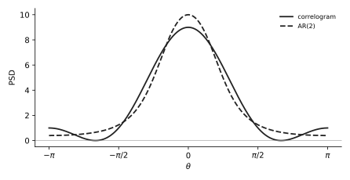

# U12 · AR model by Yule–Walker: coefficients, noise variance, PSD

Rank 6 · 5.7 points over 7 sittings1 p in Jun 2026, 0.5 to 1 p every exam70 min

!!! need "Before this page"
    [M3 rules 2 and 3](maths.md#m3-complex-exponentials-and-cosine-identities) (expanding $|1 + a_1e^{-j\theta} + a_2e^{-j2\theta}|^2$), [M7 z-domain facts](maths.md#m7-the-z-domain-in-four-facts), [M10 solving two equations](maths.md#m10-matrices-you-will-actually-invert). [U11](u11-correlogram.md) for comparison.

## The idea in plain words

An **autoregressive (AR)** model says: the signal today is a weighted sum of its own past values plus a fresh random kick (white noise). If you know the autocorrelation lags, the weights follow from a small linear system called the **Yule–Walker equations**, and the size of the kick follows from one more line. Once you have the weights, the PSD is "kick power divided by the squared magnitude of a polynomial", which you expand into cosines.

!!! idea "The thing that confused me"
    The sign of $a_1$. The course writes the model as $x[n] = i[n] - a_1x[n-1] - a_2x[n-2]$ (minus signs), so that $H(z) = 1/(1 + a_1z^{-1} + a_2z^{-2})$ with **plus** signs. With that convention $a_1 = -r[1]/r[0]$ for AR(1). If a textbook writes $x[n] = \phi x[n-1] + i[n]$ then $\phi = +r[1]/r[0] = -a_1$. Same model, flipped label. Write the model equation first, then derive; never quote a sign from memory.

## A tiny example with numbers

$r[0] = 2$, $r[1] = 1$, AR(1).
Model: $x[n] = i[n] - a_1x[n-1]$. Multiply by $x[n-1]$ and take expectations: $E[x[n]x[n-1]] = E[i[n]x[n-1]] - a_1E[x[n-1]^2]$, i.e. $r[1] = 0 - a_1r[0]$ (the fresh kick $i[n]$ is uncorrelated with the past). So $a_1 = -r[1]/r[0] = -\frac12$.
Kick power: multiply the model by $x[n]$: $r[0] = E[i[n]x[n]] - a_1r[1] = \sigma_i^2 - a_1r[1]$ (since $E[i[n]x[n]] = \sigma_i^2$). So $\sigma_i^2 = r[0] + a_1r[1] = 2 - \frac12 = 1.5$.
PSD: $\dfrac{\sigma_i^2}{|1 + a_1e^{-j\theta}|^2} = \dfrac{1.5}{1 + \frac14 - \cos\theta} = \dfrac{1.5}{1.25 - \cos\theta}$. At $0$: $6$. At $\pi$: $0.667$.

!!! question "Your turn"
    $r[0] = 4$, $r[1] = -2$. Find $a_1$, $\sigma_i^2$ and the PSD as a function of $\cos\theta$. Is it low-pass or high-pass?

    ???+ solution "Answer"
        $a_1 = -(-2)/4 = \frac12$; $\sigma_i^2 = 4 + \frac12(-2) = 3$; $P = \dfrac{3}{1 + \frac14 + \cos\theta} = \dfrac{3}{1.25 + \cos\theta}$: $1.33$ at $0$, $12$ at $\pi$: high-pass (negative lag-1 correlation).

## The formulas, every symbol named

Model: $x[n] = i[n] - \sum_{k=1}^{p}a_kx[n-k]$, $\quad H(z) = \dfrac{1}{1 + \sum_k a_kz^{-k}}$

Yule–Walker (one equation per lag $m = 1..p$): $r[m] + \sum_{k=1}^{p}a_k\,r[m-k] = 0$

Noise variance: $\sigma_i^2 = r[0] + \sum_{k=1}^{p}a_k\,r[k]$

PSD: $P_{AR}(e^{j\theta}) = \dfrac{\sigma_i^2}{\left|1 + \sum_k a_ke^{-jk\theta}\right|^2}$

| Symbol | Meaning |
|---|---|
| $p$ | model order: how many past samples enter |
| $a_k$ | AR coefficients (the unknowns) |
| $i[n]$, $\sigma_i^2$ | the innovation: white noise driving the model, and its variance |
| $r[m]$ | autocorrelation lags, given or computed ([U14](u14-model-autocorr.md)); $r[-m] = r[m]$ |
| matrix form, AR(2) | $\begin{bmatrix}r[0]&r[1]\\r[1]&r[0]\end{bmatrix}\begin{bmatrix}a_1\\a_2\end{bmatrix} = -\begin{bmatrix}r[1]\\r[2]\end{bmatrix}$, or the "augmented" form the official keys use: $\begin{bmatrix}r[0]&r[1]&r[2]\\r[1]&r[0]&r[1]\\r[2]&r[1]&r[0]\end{bmatrix}\begin{bmatrix}1\\a_1\\a_2\end{bmatrix} = \begin{bmatrix}\sigma_i^2\\0\\0\end{bmatrix}$ |

**Where Yule–Walker comes from.** Multiply the model by $x[n-m]$ and take $E[\cdot]$. For $m\ge1$ the kick term vanishes ($i[n]$ is independent of older $x$) and every $E[x[n-k]x[n-m]]$ is $r[m-k]$. For $m = 0$ the kick term is $E[i[n]x[n]] = \sigma_i^2$, giving the variance line.

**Expanding the denominator** ([M3](maths.md#m3-complex-exponentials-and-cosine-identities)): AR(1): $1 + a_1^2 + 2a_1\cos\theta$. AR(2): $(1 + a_1^2 + a_2^2) + 2(a_1 + a_1a_2)\cos\theta + 2a_2\cos2\theta$.

## What the exam asks, in its own words

| IF YOU SEE | It means |
|---|---|
| "model the signal as an AR(1) process, find the parameters" | $a_1 = -r[1]/r[0]$ and $\sigma_i^2 = r[0] + a_1r[1]$; show the two YW lines, not just the result |
| "state the Yule–Walker equations for this AR(2) process in matrix form" | write the $2\times2$ (or augmented $3\times3$) system with the numbers in |
| "calculate the AR coefficients $a_1$ and $a_2$" | solve that system by substitution, fractions kept |
| "calculate the variance of the driving white noise" | $\sigma_i^2 = r[0] + a_1r[1] + a_2r[2]$ |
| "write the expression for the parametric PSD … as a function of $\cos\theta$" | $\sigma_i^2$ over the expanded denominator |
| "$x[n] = i[n] - a_1x[n-1] - a_2x[n-2]$" written in the question | the course convention above; YW has **plus** signs on the $a_k$ |
| "some parameters may result in fractions with large numbers" | expected; keep them exact (Jan 2022: $\frac{451}{416}$) |
| "provide a sketch" | evaluate the PSD at $0$, $\pm\pi/2$, $\pm\pi$ and draw |

## Recipe

!!! recipe key "U12 · Yule–Walker in five moves"
    1. **Write the model** with the course signs: $x[n] = i[n] - a_1x[n-1] - \ldots$. Note $r[-m] = r[m]$.
    2. **Yule–Walker**: for $m = 1..p$ write $r[m] + a_1r[m-1] + \cdots + a_pr[m-p] = 0$ with numbers. AR(1): one line. AR(2): two lines (in the $m=2$ line $r[2-1] = r[1]$, $r[2-2] = r[0]$).
    3. **Solve** for the $a_k$ ([M10](maths.md#m10-matrices-you-will-actually-invert)). AR(1): $a_1 = -r[1]/r[0]$.
    4. **Variance**: $\sigma_i^2 = r[0] + a_1r[1] + \cdots + a_pr[p]$. It must be positive and $\le r[0]$; if not, a sign went wrong.
    5. **PSD**: $\sigma_i^2/|1 + a_1e^{-j\theta} + \ldots|^2$; expand the denominator with [M3](maths.md#m3-complex-exponentials-and-cosine-identities); optionally clear fractions by multiplying top and bottom. Evaluate at $0$ and $\pi$ for the sketch or the plot-matching MC.

## Worked exam question, one step at a time

!!! exam "June 2026 resit · 3d · 1 p"
    ($r_x[0] = 3$, $r_x[1] = 2$, $r_x[2] = 1$.) You now wish to model this process parametrically using an Autoregressive (AR) model of order $p = 2$: $x[n] = i[n] - a_1 x[n-1] - a_2 x[n-2]$ where $i[n]$ is zero-mean white noise with variance $\sigma_i^2$.

    - State the Yule-Walker equations for this AR(2) process in matrix form. [0.1]
    - Calculate the AR coefficients $a_1$ and $a_2$. [0.4]
    - Calculate the variance of the driving white noise $\sigma_i^2$. [0.2]
    - Based on your estimated parameters, write the expression for the parametric power spectral density estimate $\hat{P}_{AR}(e^{j\theta})$. Express it as a function of $\cos(\theta)$. [0.3]

**Step 1 · Model and matrix form.** $x[n] + a_1x[n-1] + a_2x[n-2] = i[n]$. Multiply by $x[n-1]$ and by $x[n-2]$, take expectations:

$$\begin{bmatrix}r[0]&r[1]\\r[1]&r[0]\end{bmatrix}\begin{bmatrix}a_1\\a_2\end{bmatrix} = -\begin{bmatrix}r[1]\\r[2]\end{bmatrix}\quad\Rightarrow\quad\begin{bmatrix}3&2\\2&3\end{bmatrix}\begin{bmatrix}a_1\\a_2\end{bmatrix} = -\begin{bmatrix}2\\1\end{bmatrix}.$$

(Augmented form, equally accepted: $\begin{bmatrix}3&2&1\\2&3&2\\1&2&3\end{bmatrix}\begin{bmatrix}1\\a_1\\a_2\end{bmatrix} = \begin{bmatrix}\sigma_i^2\\0\\0\end{bmatrix}$.)

**Now do step 2 yourself:** write the two equations as lines and solve them.

---

**Step 2 · Solve.** $3a_1 + 2a_2 = -2$ and $2a_1 + 3a_2 = -1$. Multiply the first by 3, the second by 2: $9a_1 + 6a_2 = -6$, $4a_1 + 6a_2 = -2$. Subtract: $5a_1 = -4 \Rightarrow a_1 = -0.8$. Back into the second: $2(-0.8) + 3a_2 = -1 \Rightarrow 3a_2 = 0.6 \Rightarrow a_2 = 0.2$.

**Now do step 3 yourself:** the variance line.

---

**Step 3 · Variance.** $\sigma_i^2 = r[0] + a_1r[1] + a_2r[2] = 3 + (-0.8)(2) + (0.2)(1) = 3 - 1.6 + 0.2 = 1.6$. Positive and below $r[0] = 3$: plausible.

**Now do step 4 yourself:** expand $|1 - 0.8e^{-j\theta} + 0.2e^{-j2\theta}|^2$ with M3 rule 3.

---

**Step 4 · PSD.** Denominator: $(1 + a_1^2 + a_2^2) + 2(a_1 + a_1a_2)\cos\theta + 2a_2\cos2\theta = (1 + 0.64 + 0.04) + 2(-0.8 - 0.16)\cos\theta + 0.4\cos2\theta = 1.68 - 1.92\cos\theta + 0.4\cos2\theta$.

$$\hat P_{AR}(e^{j\theta}) = \frac{1.6}{1.68 - 1.92\cos\theta + 0.4\cos2\theta}.$$

Check at $\theta = 0$: $\frac{1.6}{1.68 - 1.92 + 0.4} = \frac{1.6}{0.16} = 10$. At $\pi$: $\frac{1.6}{1.68 + 1.92 + 0.4} = \frac{1.6}{4} = 0.4$. Compare the correlogram of U11: 9 at 0, 1 at $\pi$. Same low-pass shape, the AR model is sharper.

<figure markdown>

<figcaption><b>How to read it.</b> Solid: correlogram $3 + 4\cos\theta + 2\cos2\theta$. Dashed: AR(2) PSD. Both peak at 0; the AR peak is 10, the correlogram 9; the AR curve stays positive and smooth.</figcaption>
</figure>

!!! answer "Answer"
    YW: $\begin{bmatrix}3&2\\2&3\end{bmatrix}\begin{bmatrix}a_1\\a_2\end{bmatrix} = -\begin{bmatrix}2\\1\end{bmatrix}$; $a_1 = -0.8$, $a_2 = 0.2$; $\sigma_i^2 = 1.6$; $\hat P_{AR} = \dfrac{1.6}{1.68 - 1.92\cos\theta + 0.4\cos2\theta}$.

## Do it cold · 1

!!! exam "April 2025 · 3e · 0.5 p"
    $r[0] = 2$, $r[\pm1] = -\frac14$, $r[\pm2] = -\frac{3}{16}$. Model the signal as an AR(1) process, find the parameters of the model, and calculate the corresponding PSD in a parametric fashion. Express $P_{AR}(e^{j\theta})$ as a function of cosines.

???+ solution "Solution"
    **YW, $m=1$.** $r[1] + a_1r[0] = 0 \Rightarrow -\frac14 + 2a_1 = 0 \Rightarrow a_1 = \frac18$. (Official matrix: $\begin{bmatrix}2&-1/4\\-1/4&2\end{bmatrix}\begin{bmatrix}1\\a_1\end{bmatrix} = \begin{bmatrix}\sigma_i^2\\0\end{bmatrix}$.)

    **Variance.** $\sigma_i^2 = r[0] + a_1r[1] = 2 + \frac18\left(-\frac14\right) = 2 - \frac1{32} = \frac{63}{32}$.

    **PSD.** $|1 + \frac18e^{-j\theta}|^2 = 1 + \frac1{64} + \frac14\cos\theta = \frac{65}{64} + \frac14\cos\theta$. $P = \dfrac{63/32}{65/64 + \frac14\cos\theta}$. Multiply top and bottom by 64: $\dfrac{126}{65 + 16\cos\theta}$. At $0$: $126/81 = 1.556$. At $\pi$: $126/49 = 2.571$.

    !!! answer "Answer"
        $a_1 = \frac18$, $\sigma_i^2 = \frac{63}{32}$, $P_{AR1}(e^{j\theta}) = \dfrac{126}{65 + 16\cos\theta}$.

## Do it cold · 2

!!! exam "November 2022 · 3f · 0.75 p"
    (The ARMA(1,1) signal of 3c–3e has $r[0] = 1$, $r[1] = -\frac18$, $r[\tau] = -\frac18(\frac34)^{|\tau|-1}$.) Try to model $x[k]$ as an AR(1) signal and calculate the corresponding PSD $P_{AR1}(e^{j\theta})$.

???+ solution "Solution"
    $a_1 = -r[1]/r[0] = \frac18$. $\sigma_i^2 = 1 + \frac18\left(-\frac18\right) = 1 - \frac1{64} = \frac{63}{64}$. $P = \dfrac{63/64}{65/64 + \frac14\cos\theta} = \dfrac{63}{65 + 16\cos\theta}$.

    !!! answer "Answer"
        $a_1 = \frac18$, $\sigma_i^2 = \frac{63}{64}$, $P_{AR1} = \dfrac{63}{65 + 16\cos\theta}$. (Compare the true ARMA PSD $28\frac{1-\cos\theta}{25-24\cos\theta}$, which is exactly 0 at $\theta=0$: an AR(1) cannot make a zero, so it only approximates.)

## Do it cold · 3 (large fractions)

!!! exam "January 2022 resit · 3d · 1 p"
    (MA(2) with $r[0] = \frac{13}{8}$, $r[\pm1] = -\frac{15}{16}$, $r[\pm2] = \frac14$.) Now assume $x[n]$ can be modeled as an AR(1) process. Find the AR model parameters and the PSD (as a function of $\cos\theta$). **Hint:** some parameters may result in fractions with large numbers.

???+ solution "Solution"
    $a_1 = -r[1]/r[0] = \frac{15/16}{13/8} = \frac{15}{16}\cdot\frac{8}{13} = \frac{15}{26}$. $\sigma_i^2 = \frac{13}{8} + \frac{15}{26}\left(-\frac{15}{16}\right) = \frac{13}{8} - \frac{225}{416} = \frac{676}{416} - \frac{225}{416} = \frac{451}{416}$.
    Denominator: $1 + \frac{225}{676} + \frac{15}{13}\cos\theta = \frac{901}{676} + \frac{15}{13}\cos\theta$. $P = \dfrac{451/416}{901/676 + \frac{15}{13}\cos\theta}$. Multiply top and bottom by $676\cdot\frac{416}{416}$: numerator $\frac{451\cdot676}{416} = 451\cdot\frac{13}{8} = \frac{5863}{8}$, denominator $901 + 780\cos\theta$; then by 8: $\dfrac{5863}{7208 + 6240\cos\theta}$.

    !!! answer "Answer"
        $a_1 = \frac{15}{26}$, $\sigma_i^2 = \frac{451}{416}$, $P = \dfrac{5863}{7208 + 6240\cos\theta}$ ($\approx 0.436$ at $0$, $6.06$ at $\pi$). Fallback values $a=\frac14$, $b=\frac54$: $a_1 = -\frac{3}{14}$, $\sigma_i^2 = \frac{561}{224}$, $P = \frac{3927}{1640 - 672\cos\theta}$.

## Do it cold · 4 (AR(2) with ugly numbers)

!!! exam "April 2024 · 3e · 0.7 p"
    ($r[0] = \frac{25}{16}$, $r[\pm1] = -\frac34$, $r[\pm2] = \frac12$ from the MA(3) of 3c.) Now model the signal as AR(2) process. Find the model parameters and the power spectral density.

???+ solution "Solution"
    **YW.** $m=1$: $r[1] + a_1r[0] + a_2r[1] = 0 \Rightarrow -\frac34 + \frac{25}{16}a_1 - \frac34a_2 = 0$. $m = 2$: $r[2] + a_1r[1] + a_2r[0] = 0 \Rightarrow \frac12 - \frac34a_1 + \frac{25}{16}a_2 = 0$. Multiply both by 16: $25a_1 - 12a_2 = 12$ and $-12a_1 + 25a_2 = -8$. From the first, $a_1 = \frac{12 + 12a_2}{25}$. Into the second: $-12\cdot\frac{12+12a_2}{25} + 25a_2 = -8 \Rightarrow -144 - 144a_2 + 625a_2 = -200 \Rightarrow 481a_2 = -56 \Rightarrow a_2 = -\frac{56}{481}$. Then $a_1 = \frac{12 - 672/481}{25} = \frac{(5772 - 672)/481}{25} = \frac{5100}{481\cdot25} = \frac{204}{481}$.

    **Variance.** $\sigma_i^2 = \frac{25}{16} + \frac{204}{481}\left(-\frac34\right) + \left(-\frac{56}{481}\right)\frac12 = \frac{25}{16} - \frac{153}{481} - \frac{28}{481} = \frac{25}{16} - \frac{181}{481} = \frac{9129}{7696} \approx 1.186$.

    **PSD.** Denominator $(1 + a_1^2 + a_2^2) + 2(a_1 + a_1a_2)\cos\theta + 2a_2\cos2\theta \approx 1.193 + 0.750\cos\theta - 0.233\cos2\theta$. $P_{AR2}\approx\dfrac{1.186}{1.193 + 0.750\cos\theta - 0.233\cos2\theta}$: $0.69$ at $0$, $5.6$ at $\pi$. High-pass, like the correlogram ($0.06$ at $0$, $5.06$ at $\pi$) but without the zero: that is plot B in 3f.

    !!! answer "Answer"
        $a_1 = \frac{204}{481}\approx0.424$, $a_2 = -\frac{56}{481}\approx-0.116$, $\sigma_i^2 = \frac{9129}{7696}\approx1.186$, $P_{AR2}(e^{j\theta}) = \dfrac{1.186}{1.193 + 0.750\cos\theta - 0.233\cos2\theta}$.

## Do it cold · 5

!!! exam "November 2019 · 2b · 1 p"
    ($r[0] = 1$, $r[\pm1] = 0.7$, $r[\pm2] = 0.5$, $r[\pm3] = 0.3$.) Assume $x[n]$ is modeled by an AR(2) model. Determine and plot its spectrum estimate.

???+ solution "Solution"
    YW: $0.7 + a_1 + 0.7a_2 = 0$ and $0.5 + 0.7a_1 + a_2 = 0$. From the first $a_1 = -0.7 - 0.7a_2$; into the second: $0.5 - 0.49 - 0.49a_2 + a_2 = 0 \Rightarrow 0.51a_2 = -0.01 \Rightarrow a_2 = -0.0196$; $a_1 = -0.7 + 0.0137 = -0.6863$. $\sigma_i^2 = 1 + (-0.6863)(0.7) + (-0.0196)(0.5) = 1 - 0.4804 - 0.0098 = 0.5098$.

    !!! answer "Answer"
        $P_{AR2}(e^{j\theta}) = \dfrac{0.5098}{|1 - 0.6863e^{-j\theta} - 0.0196e^{-j2\theta}|^2}$ (the key prints $0.5089$); peak $\approx 5.9$ at $\theta=0$, about $0.18$ at $\pi$; sharper than the correlogram's peak of 4.

## Do it cold · 6

!!! exam "October 2021 · 3b · 0.75 p"
    ($\rho[0] = \frac{28}{27}$, $\rho[\pm1] = -\frac4{27}$.) Model the signal as AR(1): find the parameters and $P_{AR1}(e^{j\theta})$, and sketch.

???+ solution "Solution"
    $a_1 = -\rho[1]/\rho[0] = \frac{4/27}{28/27} = \frac17$. $\sigma_i^2 = \frac{28}{27} + \frac17\left(-\frac4{27}\right) = \frac{28}{27} - \frac{4}{189} = \frac{196 - 4}{189} = \frac{192}{189} = \frac{64}{63}$. Denominator $1 + \frac1{49} + \frac27\cos\theta = \frac{50}{49} + \frac27\cos\theta$. $P = \frac{64/63}{50/49 + \frac27\cos\theta} = \frac{64\cdot49}{63(50 + 14\cos\theta)} = \frac{3136}{3150 + 882\cos\theta} = \frac{224}{225 + 63\cos\theta}$.

    !!! answer "Answer"
        $a_1 = \frac17$, $\sigma_i^2 = \frac{64}{63}$, $P_{AR1} = \dfrac{224}{225 + 63\cos\theta}$ ($0.78$ at $0$, $1.38$ at $\pi$).

## Where points get lost

!!! trap key "Where points get lost"
    | Wrong line | Right line |
    |---|---|
    | $a_1 = r[1]/r[0]$ | With the course model $x = i - a_1x[n-1]$: $a_1 = -r[1]/r[0]$. Derive the sign from the model each time. |
    | $\sigma_i^2 = r[0] - a_1r[1]$ | $\sigma_i^2 = r[0] + a_1r[1]$ (same convention). Check: must be $0 < \sigma_i^2 \le r[0]$. |
    | Denominator $1 + a_1^2 + a_1\cos\theta$ | The cross term is $2a_1\cos\theta$. |
    | AR(2) denominator $1 + a_1^2 + a_2^2 + 2a_1\cos\theta + 2a_2\cos2\theta$ | The $\cos\theta$ coefficient is $2(a_1 + a_1a_2)$; the product term is the usual omission. |
    | Using $r[2]$ in an AR(1) fit | AR(1) uses $r[0]$ and $r[1]$ only; the model then *predicts* $r[2] = -a_1r[1]$, which need not match the given one. |
    | Decimal rounding mid-way (Jan 2022) | Keep $\frac{15}{26}$, $\frac{451}{416}$; the exam warns about big fractions on purpose. |

## True or false (from real MC options)

| statement | T or F | why |
|---|---|---|
| Estimating the PSD by modelling the random signal as a linear random signal model is parametric spectral estimation (AR, MA, ARMA). | True | Apr 2024 3a row 1. |
| A PSD estimated with a model of the form $\sigma_i^2\lvert(1+\sum b_qe^{-jq\theta})/(1+\sum a_pe^{-jp\theta})\rvert^2$ is ARMA modelling. | True | Apr 2025 3c statement 3. |
| The Wiener FIR filter for 1-step linear prediction can be used for moving-average parametric spectral estimation. | False | Nov 2019 1b (E): linear prediction gives the **AR** coefficients (same equations as Yule–Walker), not MA. |
| Assuming an MA model, parametric spectral estimation by Yule–Walker requires solving non-linear equations. | True | Jan 2019 1d (C): MA parameters appear in products ($r[1] = \sigma_i^2b_1$, $r[0] = \sigma_i^2(1+b_1^2)$): see [U13](u13-ma.md). |
| Any arbitrary power spectrum, even one with deep nulls from an MA process, can be approximated by an AR model. | True | Jun 2026 3e (3): provided the AR order $p$ is made large enough (an MA zero needs infinitely many poles to be matched exactly). |

**You can leave this page when you can:**

- [ ] derive $r[1] + a_1r[0] = 0$ from the model by multiplying and taking expectations.
- [ ] solve a $2\times2$ Yule–Walker system with fractions.
- [ ] write $\sigma_i^2$ and check it lies in $(0, r[0]]$.
- [ ] expand the AR(2) denominator into cosines including the $a_1a_2$ term.
- [ ] evaluate the PSD at $0$ and $\pi$ and say low-pass or high-pass.

*[autoregressive]: a model where the current sample is a linear combination of past samples plus white noise.
*[Yule–Walker]: the linear equations linking AR coefficients to autocorrelation lags.
*[innovation]: the white-noise input of a linear signal model.
