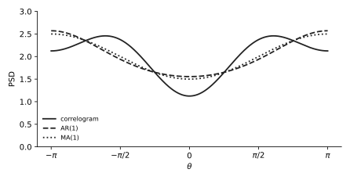
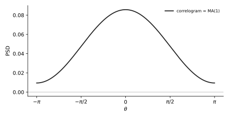

# U13 · MA model from the lags: a quadratic, a minimum-phase choice, a PSD

Rank 9 · 3.45 points over 4 sittings0.5 p in Apr 2025, 0.75 in Nov 2022, 1 p in Jan 2022 and Jan 202050 min

!!! need "Before this page"
    [M6 white-noise expectations](maths.md#m6-expectation-and-variance-rules), [M8 quadratic formula](maths.md#m8-argmax-set-the-derivative-to-zero-quadratics), [M3 rule 2](maths.md#m3-complex-exponentials-and-cosine-identities), [M7 minimum phase](maths.md#m7-the-z-domain-in-four-facts). [U12](u12-ar.md) for the contrast.

## The idea in plain words

A **moving-average (MA)** model says: the signal today is a weighted sum of the **last few noise kicks**, not of its own past. Because the kicks are independent, the autocorrelation is a short list: products of weights that overlap. Going backwards (lags → weights) means solving those product equations, which are quadratic. Two roots appear; you keep the one that makes the filter **minimum phase** (zero inside the unit circle).

!!! idea "The thing that confused me"
    Why is the MA fit "non-linear" when the AR fit was a linear system? In AR the unknown $a_k$ multiply known lags. In MA the unknowns multiply **each other**: $r[0] = \sigma_i^2(1 + b_1^2)$, $r[1] = \sigma_i^2b_1$. Dividing the two kills $\sigma_i^2$ and leaves $b_1/(1+b_1^2)$: a quadratic in $b_1$. That is the Jan 2019 MC fact "MA by Yule–Walker requires non-linear equations".

## A tiny example with numbers

MA(1): $x[n] = i[n] + b_1i[n-1]$, $\sigma_i^2 = 1$, $b_1 = 0.5$. Forward direction (weights → lags), using [M6](maths.md#m6-expectation-and-variance-rules): only equal-time kicks survive.
$r[0] = E[(i[n] + 0.5i[n-1])^2] = 1 + 0.25 = 1.25$. $r[1] = E[(i[n] + 0.5i[n-1])(i[n-1] + 0.5i[n-2])] = 0.5\cdot1 = 0.5$. $r[2] = 0$ (no overlap).
Backward direction (lags → weights): $\frac{r[1]}{r[0]} = \frac{b_1}{1+b_1^2} = \frac{0.5}{1.25} = 0.4 \Rightarrow 0.4b_1^2 - b_1 + 0.4 = 0 \Rightarrow b_1 = \frac{1\pm\sqrt{1 - 0.64}}{0.8} = \frac{1\pm0.6}{0.8}$: $2$ or $0.5$. Keep $0.5$ ($|b_1|<1$). Then $\sigma_i^2 = r[1]/b_1 = 1$. Round trip closed.

!!! question "Your turn"
    $r[0] = 2.5$, $r[1] = -1$. Find $b_1$ (minimum phase) and $\sigma_i^2$.

    ???+ solution "Answer"
        $\frac{b_1}{1+b_1^2} = -0.4 \Rightarrow 0.4b_1^2 + b_1 + 0.4 = 0 \Rightarrow b_1 = \frac{-1\pm0.6}{0.8}$: $-0.5$ or $-2$. Keep $-0.5$; $\sigma_i^2 = (-1)/(-0.5) = 2$.

## The formulas, every symbol named

MA(1): $x[n] = i[n] + b_1i[n-1]$: $\quad r[0] = \sigma_i^2(1 + b_1^2)$, $\quad r[1] = \sigma_i^2b_1$, $\quad r[k] = 0$ for $|k|\ge2$

MA(2): $x[n] = i[n] + b_1i[n-1] + b_2i[n-2]$: $\quad r[0] = \sigma_i^2(1 + b_1^2 + b_2^2)$, $\quad r[1] = \sigma_i^2(b_1 + b_1b_2)$, $\quad r[2] = \sigma_i^2b_2$

PSD: $P_{MA}(e^{j\theta}) = \sigma_i^2\left|1 + \sum_k b_ke^{-jk\theta}\right|^2 = r[0] + 2\sum_{k=1}^{q}r[k]\cos k\theta$

| Symbol | Meaning |
|---|---|
| $q$ | MA order: how many past kicks enter; lags beyond $q$ are exactly zero |
| $b_k$ | MA coefficients (zeros of $H(z) = 1 + \sum b_kz^{-k}$) |
| $\sigma_i^2$ | variance of the white input |
| minimum phase | the root with $\lvert b_1\rvert < 1$ (MA(1)); for MA(2) both zeros of $1 + b_1z^{-1} + b_2z^{-2}$ inside the unit circle |

**General rule** (used for any MA($q$)): $r[k] = \sigma_i^2\sum_{m=0}^{q-k}b_mb_{m+k}$ with $b_0 = 1$: slide the coefficient list over itself by $k$ and add the products of what overlaps.

**Why the PSD equals the correlogram.** An MA($q$) has exactly $q$ nonzero lags, so $r[0] + 2\sum_{k\le q}r[k]\cos k\theta$ is not a truncation: it is exact. If the given lags come from a true MA($q$) (Jan 2020), the MA fit and the correlogram coincide. If they come from something else (Apr 2025: $r[2]\ne0$ but an MA(1) is fitted), the MA(1) PSD is $r[0] + 2r[1]\cos\theta$, which **ignores** $r[2]$.

## What the exam asks, in its own words

| IF YOU SEE | It means |
|---|---|
| "model the signal as an MA(1) process, find the parameters" | solve $b_1/(1+b_1^2) = r[1]/r[0]$, choose $\lvert b_1\rvert<1$, then $\sigma_i^2 = r[1]/b_1$ |
| "you can approximate the model parameters … by decimal numbers" | the quadratic has a square root ($\sqrt{15}$): $-4 + \sqrt{15}\approx-0.127$ is fine |
| "a real MA(2) process … calculate the parameters $a$ and $b$" from $r[1]$, $r[2]$ with unit-variance input | $b = r[2]$ directly, then $a = r[1]/(1+b)$ |
| "how does this relate to the spectrum obtained in 3(a)? Motivate" | say whether the fit reproduces all nonzero lags (then identical) or drops some (then different), and why |
| "choose the solution which gives a minimum-phase system" | keep the root inside the unit circle |

## Recipe

!!! recipe key "U13 · MA(1) in four moves (MA(2) in three)"
    1. **Ratio.** $\dfrac{r[1]}{r[0]} = \dfrac{b_1}{1 + b_1^2}$. Call the ratio $\rho$.
    2. **Quadratic.** $\rho b_1^2 - b_1 + \rho = 0 \Rightarrow b_1 = \dfrac{1\pm\sqrt{1 - 4\rho^2}}{2\rho}$. The two roots multiply to 1; keep the one with $\lvert b_1\rvert < 1$ (minimum phase).
    3. **Variance.** $\sigma_i^2 = r[1]/b_1$. Check: $\sigma_i^2(1 + b_1^2)$ must give back $r[0]$.
    4. **PSD.** $\sigma_i^2(1 + b_1^2 + 2b_1\cos\theta) = r[0] + 2r[1]\cos\theta$. Evaluate at $0$ and $\pi$.

    MA(2) with unit input variance: $b_2 = r[2]$; $b_1 = r[1]/(1 + b_2)$; $r[0] = 1 + b_1^2 + b_2^2$ (then [U11](u11-correlogram.md) for the PSD).

## Worked exam question, one step at a time

!!! exam "April 2025 · 3f · 0.5 p"
    ($r[0] = 2$, $r[\pm1] = -\frac14$, $r[\pm2] = -\frac{3}{16}$.) Model the signal as an MA(1) process, find the parameters of the model, and calculate the corresponding power spectral density in a parametric fashion. Express $P_{MA}(e^{j\theta})$ as a function of cosines.

**Step 1 · Ratio.** $\rho = \dfrac{r[1]}{r[0]} = \dfrac{-1/4}{2} = -\dfrac18$. So $\dfrac{b_1}{1+b_1^2} = -\dfrac18$. (Lag 2 is not used by an MA(1).)

**Now do step 2 yourself:** cross-multiply into a quadratic and solve it.

---

**Step 2 · Quadratic.** $8b_1 = -(1 + b_1^2) \Rightarrow b_1^2 + 8b_1 + 1 = 0$. $b_1 = \dfrac{-8\pm\sqrt{64 - 4}}{2} = \dfrac{-8\pm\sqrt{60}}{2} = -4\pm\sqrt{15}$. $\sqrt{15} = 3.873$: roots $-0.127$ and $-7.873$. Keep $b_1 = -4 + \sqrt{15}\approx-0.127$ (inside the unit circle).

**Now do step 3 yourself:** the variance, and the check against $r[0]$.

---

**Step 3 · Variance.** $\sigma_i^2 = \dfrac{r[1]}{b_1} = \dfrac{-0.25}{-0.127} = 1.968$. Check: $1.968(1 + 0.0161) = 2.000$. ✓

**Now do step 4 yourself:** the PSD in cosines, two ways.

---

**Step 4 · PSD.** $P_{MA} = 1.968\,|1 - 0.127e^{-j\theta}|^2 = 1.968(1 + 0.0161 - 0.254\cos\theta) = 2.000 - 0.500\cos\theta$. Shortcut: $r[0] + 2r[1]\cos\theta = 2 - 0.5\cos\theta$. Same. At $0$: $1.5$; at $\pi$: $2.5$. Compare the correlogram $2 - 0.5\cos\theta - 0.375\cos2\theta$ ($1.125$ at 0, $2.125$ at $\pi$) and the AR(1) $126/(65+16\cos\theta)$ ($1.556$ at 0, $2.571$ at $\pi$): AR(1) and MA(1) almost overlap, which is the clue for plot D in 3g.

<figure markdown>

<figcaption><b>How to read it.</b> Solid: correlogram (dips to about 1.1 at 0, bumps near $\pm0.6\pi$). Dashed: AR(1). Dotted: MA(1). The two parametric curves sit on top of each other, minimum 1.5 at 0, maximum 2.5 at $\pm\pi$.</figcaption>
</figure>

!!! answer "Answer"
    $b_1 = -4 + \sqrt{15}\approx-0.13$, $\sigma_i^2\approx1.97$, $P_{MA}(e^{j\theta})\approx 2 - 0.5\cos\theta$.

## Do it cold · 1

!!! exam "November 2022 · 3g · 0.75 p"
    ($r[0] = 1$, $r[\pm1] = -\frac18$, $r[\tau] = -\frac18(\frac34)^{|\tau|-1}$.) Try to model $x[k]$ as a MA(1) signal and calculate the corresponding PSD $P_{MA1}(e^{j\theta})$. You can approximate the model parameters and the resulting PSD expression by using decimal numbers.

???+ solution "Solution"
    $\rho = -\frac18$: the same quadratic as above, $b_1 = -4 + \sqrt{15} = -0.127$. $\sigma_i^2 = r[1]/b_1 = \frac{-0.125}{-0.127} = 0.984$. $P = 0.984|1 - 0.127e^{-j\theta}|^2 = r[0] + 2r[1]\cos\theta = 1 - 0.25\cos\theta$.

    !!! answer "Answer"
        $b_1\approx-0.13$, $\sigma_i^2\approx0.98$, $P_{MA1}(e^{j\theta}) = 1 - 0.25\cos\theta$. (The true ARMA(1,1) PSD has a zero at $\theta = 0$; the MA(1) fit gives $0.75$ there: it only matches lags 0 and 1.)

## Do it cold · 2 (MA(2), weights from lags)

!!! exam "January 2022 resit · 3b · 1 p"
    A real MA(2) process has difference equation $x[n] = i[n] + ai[n-1] + bi[n-2]$, with $i[n]$ white noise (zero mean, unit variance). The following lags are known: $r_x[\tau] = -\frac{15}{16}$ for $\tau = \pm1$, $\frac14$ for $\tau = \pm2$. Calculate the parameters $a$ and $b$.

???+ solution "Solution"
    **Forward formulas** (slide the list $[1, a, b]$ over itself): $r[2] = E[(i[n] + ai[n-1] + bi[n-2])(i[n-2] + ai[n-3] + bi[n-4])]$: only $i[n-2]$ appears in both, with coefficients $b$ and $1$: $r[2] = b$. $r[1]$: overlaps $i[n-1]$ ($a\cdot1$) and $i[n-2]$ ($b\cdot a$): $r[1] = a + ab = a(1+b)$.

    **Solve.** $b = r[2] = \frac14$. $a(1 + \frac14) = -\frac{15}{16} \Rightarrow a = -\frac{15}{16}\cdot\frac45 = -\frac34$.

    **Check minimum phase.** $H(z) = 1 - \frac34z^{-1} + \frac14z^{-2}$; zeros solve $z^2 - \frac34z + \frac14 = 0$: $z = \frac{0.75\pm\sqrt{0.5625 - 1}}{2}$, complex with $|z|^2 = \frac14$, so $|z| = 0.5 < 1$. ✓ (And $r[0] = 1 + a^2 + b^2 = \frac{13}{8}$ for 3c.)

    !!! answer "Answer"
        $a = -\frac34$, $b = \frac14$.

## Do it cold · 3 (MA(1) that is exact)

!!! exam "January 2020 retake · 3b · 1.2 p"
    $r_x[0] = \frac{1}{21}$, $r_x[\pm1] = \frac{2}{105}$, $0$ else. Assume $x[n]$ can be modeled by an MA(1) random process. Determine and plot its spectrum estimate. How does this relate to the spectrum estimate obtained in 3(a) (the correlogram)? Motivate your answer.

???+ solution "Solution"
    $\rho = \frac{2/105}{1/21} = \frac{2}{105}\cdot21 = \frac{42}{105} = \frac25$. $\frac25b_1^2 - b_1 + \frac25 = 0 \Rightarrow 2b_1^2 - 5b_1 + 2 = 0 \Rightarrow b_1 = \frac{5\pm\sqrt{25-16}}{4} = \frac{5\pm3}{4}$: $2$ or $\frac12$. Keep $b_1 = \frac12$. $\sigma_i^2 = \frac{2/105}{1/2} = \frac{4}{105}$. PSD: $\frac{4}{105}|1 + \frac12e^{-j\theta}|^2 = \frac{4}{105}\left(\frac54 + \cos\theta\right) = \frac{1}{21} + \frac{4}{105}\cos\theta$.

    **Relation.** Identical to the correlogram of 3(a). Reason: the given autocorrelation has only lags $0, \pm1$, exactly the signature of an MA(1); the fitted MA(1) reproduces both lags, and the MA(1) PSD is by construction $r[0] + 2r[1]\cos\theta$, which is the correlogram. Nothing is truncated or ignored.

    <figure markdown>
    
    <figcaption><b>How to read it.</b> One curve: peak $9/105 = 0.0857$ at $\theta=0$, minimum $1/105 = 0.0095$ at $\pm\pi$.</figcaption>
    </figure>

    !!! answer "Answer"
        $b_1 = \frac12$, $\sigma_i^2 = \frac{4}{105}$, $P_{MA1} = \frac1{21} + \frac4{105}\cos\theta$, the same as the correlogram because the process is exactly MA(1).

## Where points get lost

!!! trap key "Where points get lost"
    | Wrong line | Right line |
    |---|---|
    | $b_1 = r[1]/r[0]$ | That is (minus) the AR coefficient. For MA: $r[1]/r[0] = b_1/(1+b_1^2)$, a quadratic. |
    | Keeping the root $b_1 = -7.87$ | The two roots multiply to 1; keep the one with $\lvert b_1\rvert<1$. Say "minimum phase". |
    | $\sigma_i^2 = r[0]$ | $\sigma_i^2 = r[1]/b_1$ (or $r[0]/(1+b_1^2)$). |
    | Using $r[2]$ in an MA(1) fit | MA(1) uses lags 0 and 1 only; say explicitly that $r[2]$ is dropped. |
    | $r[1] = a + b$ for an MA(2) | $r[1] = a + ab$: overlapping products, not a sum of coefficients. |
    | Writing $P_{MA} = \sigma_i^2\lvert1 + b_1e^{-j\theta}\rvert$ | Squared magnitude: $\sigma_i^2(1 + b_1^2 + 2b_1\cos\theta)$. |

## True or false (from real MC options)

| statement | T or F | why |
|---|---|---|
| The autocorrelation of an MA($q$) process is zero for lags beyond $q$. | True | Jan 2022 3c hint: "the autocorrelation of a MA process is of finite length". |
| Fitting an MA model by matching autocorrelation lags requires solving non-linear equations. | True | Jan 2019 1d (C). |
| The autocorrelation matrix of an ARMA model is diagonal. | False | Jan 2019 1d (B): only white noise has a diagonal (all lags beyond 0 zero) autocorrelation matrix. |
| Linear signal models can be used for data compression. | True | Jan 2019 1d (D): a few coefficients plus white noise describe the whole signal. |
| If a process is exactly MA(1), the MA(1) parametric PSD and the correlogram from lags 0 and ±1 coincide. | True | Jan 2020 3b. |

**You can leave this page when you can:**

- [ ] turn $r[1]/r[0]$ into the quadratic $\rho b_1^2 - b_1 + \rho = 0$ and solve it.
- [ ] pick the minimum-phase root and justify it in four words.
- [ ] get $\sigma_i^2$ and verify $r[0]$.
- [ ] write the MA(1) PSD both as $\sigma_i^2|1+b_1e^{-j\theta}|^2$ and as $r[0] + 2r[1]\cos\theta$.
- [ ] read $b_2 = r[2]$ and $b_1 = r[1]/(1+b_2)$ off an MA(2) with unit input.

*[moving average]: a model where the current sample is a weighted sum of the last few white-noise inputs.
*[minimum phase]: all zeros (and poles) inside the unit circle; the invertible, causal choice.
