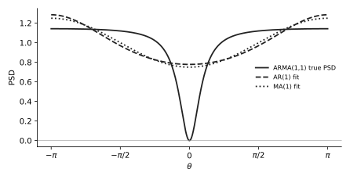

# U14 · From a difference equation to r[k] and the PSD

Rank 15 · 2.1 points over 4 sittings0.6 p in Apr 2024, 1 p in Nov 2022, 0.75 p in Oct 202160 min

!!! need "Before this page"
    [M6 white-noise expectations](maths.md#m6-expectation-and-variance-rules) (only equal-time kicks survive), [M7 z-domain](maths.md#m7-the-z-domain-in-four-facts) (difference equation ↔ $H(z)$), [M3 rule 2](maths.md#m3-complex-exponentials-and-cosine-identities).

## The idea in plain words

The exam hands you the recipe that generates a signal (a difference equation or a filter $H(z)$ fed with white noise) and asks for the signal's autocorrelation and PSD. Two mechanical routes: for the **PSD**, take $|H|^2$ at $z = e^{j\theta}$ and multiply by the noise variance. For the **autocorrelation**, multiply the equation by a delayed copy of the signal and take expectations, using that white-noise kicks at different times are uncorrelated.

!!! idea "The thing that confused me"
    In an ARMA equation like $x[n] = i[n] - i[n-1] + \frac34x[n-1]$ the past signal $x[n-1]$ is **not** independent of the past kick $i[n-1]$: $x[n-1]$ contains $i[n-1]$ with coefficient 1. So $E[x[n-1]\,i[n-1]] = \sigma_i^2$, not zero. What *is* zero is $E[x[n-1]\,i[n]]$: the past cannot know the future kick. Write "coefficient of $i[n-m]$ inside $x[n-m]$ is $b_0 = 1$" before you start.

## A tiny example with numbers

$x[n] = i[n] + 2i[n-1]$, $\sigma_i^2 = 1$ (MA(1)).
PSD route: $H(z) = 1 + 2z^{-1}$, $P = 1\cdot|1 + 2e^{-j\theta}|^2 = 1 + 4 + 4\cos\theta = 5 + 4\cos\theta$.
Autocorrelation route: $r[0] = E[(i[n]+2i[n-1])^2] = 1 + 4 = 5$; $r[1] = E[(i[n]+2i[n-1])(i[n-1]+2i[n-2])] = 2$; $r[2] = 0$. Correlogram: $5 + 4\cos\theta$. Same answer, as it must be.

!!! question "Your turn"
    $x[n] = i[n] - \frac12 i[n-1]$, $\sigma_i^2 = 4$. Find $r[0]$, $r[1]$ and the PSD by both routes.

    ???+ solution "Answer"
        $r[0] = 4(1 + \frac14) = 5$, $r[1] = 4(-\frac12) = -2$. PSD $= 4|1 - \frac12e^{-j\theta}|^2 = 4(1 + \frac14 - \cos\theta) = 5 - 4\cos\theta = r[0] + 2r[1]\cos\theta$. ✓

## The formulas, every symbol named

Difference equation $x[n] = \sum_{k=0}^{q}b_ki[n-k] - \sum_{k=1}^{p}a_kx[n-k]$ $\;\Leftrightarrow\;$ $H(z) = \dfrac{\sum_k b_kz^{-k}}{1 + \sum_k a_kz^{-k}}$, $b_0 = 1$

PSD: $P_x(e^{j\theta}) = \sigma_i^2\,|H(e^{j\theta})|^2 = \sigma_i^2\dfrac{|1 + b_1e^{-j\theta} + \ldots|^2}{|1 + a_1e^{-j\theta} + \ldots|^2}$

Autocorrelation: $r[m] = E[x[n]\,x[n-m]]$, computed by multiplying the equation by $x[n-m]$ and using $E[i[n]\,i[n-k]] = \sigma_i^2\delta[k]$, $E[i[n]\,x[n-m]] = 0$ for $m\ge1$, $E[i[n-m]\,x[n-m]] = \sigma_i^2$

| Model | Name | How to recognise |
|---|---|---|
| only $i$ terms on the right | MA($q$), $q$ = oldest kick | finite autocorrelation (lags $0..q$) |
| $i[n]$ plus past $x$ terms | AR($p$), $p$ = oldest $x$ | $r[m]$ decays geometrically forever |
| both past $i$ and past $x$ | ARMA($p,q$) | first $q$ lags special, then geometric decay |

**Why $E[i[n]\,x[n-m]] = 0$ for $m\ge1$.** $x[n-m]$ is built from kicks up to time $n-m$; the kick $i[n]$ is later and independent of all of them.

## What the exam asks, in its own words

| IF YOU SEE | It means |
|---|---|
| "which kind of signal model does this signal represent?" | count the oldest $i$ term and the oldest $x$ term: MA($q$), AR($p$) or ARMA($p,q$) |
| "calculate the autocorrelation function of $x[n]$" (MA) | $r[k] = \sigma_i^2\sum_m b_mb_{m+k}$: slide the coefficient list over itself |
| "calculate the autocorrelation $r[\tau]$" (ARMA) | $r[0]$ and $r[1]$ by the multiply-and-expect method (two equations), then $r[\tau] = -a_1r[\tau-1]$ for $\tau\ge2$ |
| "calculate the PSD $P_x(e^{j\theta})$ of $x[k]$" | $\sigma_i^2\lvert H(e^{j\theta})\rvert^2$, numerator and denominator expanded with M3 |
| "generated by filtering innovation $i[k]$ with the filter $H(z) = \ldots$" | first convert $H(z)$ to the difference equation (M7), then as above |
| "if you could not solve 3a, use the following autocorrelation" | fallback values; use them and say so |

## Recipe

!!! recipe key "U14 · Model to lags and PSD"
    1. **Write the equation and name it** (MA/AR/ARMA, orders). If given $H(z)$, convert: numerator coefficients → $b_k$ on $i[n-k]$, denominator $1 + a_1z^{-1}$ → $-a_1x[n-1]$ on the right.
    2. **PSD**: $\sigma_i^2|H(e^{j\theta})|^2$; expand $|1 + ce^{-j\theta}|^2 = 1 + c^2 + 2c\cos\theta$ top and bottom; simplify fractions.
    3. **MA lags**: $r[k] = \sigma_i^2\sum_m b_mb_{m+k}$ for $k = 0..q$, zero beyond.
    4. **ARMA(1,1) lags** ($x[n] = i[n] + b_1i[n-1] - a_1x[n-1]$): multiply by $x[n]$: $r[0] = \sigma_i^2(1 + b_1^2) - a_1r[1] - a_1b_1\sigma_i^2\cdot$… do it as in the worked example below: expand $E[x[n]^2]$ term by term, using $E[x[n-1]i[n-1]] = \sigma_i^2$. Multiply by $x[n-1]$: $r[1] = b_1\sigma_i^2 - a_1r[0]$. Two equations, two unknowns. Then $r[\tau] = -a_1r[\tau-1]$ for $\tau\ge2$.
    5. **Check**: $r[0] > 0$, $|r[1]| < r[0]$, and the correlogram built from your lags should match the PSD of step 2 at $\theta = 0$ (for MA) or at least have the same shape.

## Worked exam question, one step at a time

!!! exam "November 2022 · 3c + 3d + 3e · 0.15 + 0.35 + 0.5 p"
    The random signal $x[k]$ is described by the following difference equation: $x[k] = i[k] - i[k-1] + \frac34x[k-1]$, with $i[k]$ the innovation signal (zero mean and $\sigma_i^2 = \frac78$).

    **3c** Which kind of process does $x[k]$ represent? **3d** Calculate the power spectral density $P_x(e^{j\theta})$ of $x[k]$. **3e** Calculate the autocorrelation $r[\tau]$ of $x[k]$.

**Step 1 · Name it.** Past kick $i[k-1]$ (so $q = 1$) and past signal $x[k-1]$ (so $p = 1$): **ARMA(1,1)**. In the course convention $b_1 = -1$, $a_1 = -\frac34$ (because $-a_1x[k-1] = +\frac34x[k-1]$). $H(z) = \dfrac{1 - z^{-1}}{1 - \frac34z^{-1}}$.

**Now do step 2 yourself:** PSD $= \sigma_i^2|H(e^{j\theta})|^2$, expand numerator and denominator.

---

**Step 2 · PSD.** Numerator: $|1 - e^{-j\theta}|^2 = 1 + 1 - 2\cos\theta = 2 - 2\cos\theta$. Denominator: $|1 - \frac34e^{-j\theta}|^2 = 1 + \frac{9}{16} - \frac32\cos\theta = \frac{25}{16} - \frac32\cos\theta$.

$$P_x(e^{j\theta}) = \frac78\cdot\frac{2 - 2\cos\theta}{\frac{25}{16} - \frac32\cos\theta}.$$

Multiply top and bottom by 16: $\frac78\cdot\frac{32 - 32\cos\theta}{25 - 24\cos\theta} = \frac{28(1 - \cos\theta)}{25 - 24\cos\theta}$. At $\theta = 0$: $0$ (the zero of $1 - z^{-1}$ at $z = 1$ kills DC). At $\pi$: $\frac{56}{49} = 1.143$.

**Now do step 3 yourself:** $r[0]$. Square the equation, take $E$, remember $E[x[k-1]\,i[k-1]] = \sigma_i^2$ and $E[x[k-1]\,i[k]] = 0$.

---

**Step 3 · $r[0]$.** $x = i - i_1 + \frac34x_1$ (short names: $i_1 = i[k-1]$, $x_1 = x[k-1]$). Square: $x^2 = i^2 + i_1^2 + \frac{9}{16}x_1^2 - 2ii_1 + \frac32ix_1 - \frac32i_1x_1$. Expectations: $E[i^2] = E[i_1^2] = \frac78$; $E[x_1^2] = r[0]$; $E[ii_1] = 0$; $E[ix_1] = 0$ (future kick); $E[i_1x_1] = \sigma_i^2 = \frac78$ (the coefficient of $i_1$ inside $x_1$ is $b_0 = 1$).

$r[0] = \frac78 + \frac78 + \frac{9}{16}r[0] - 0 + 0 - \frac32\cdot\frac78 = \frac{14}{8} - \frac{21}{16} + \frac{9}{16}r[0] = \frac{28 - 21}{16} + \frac{9}{16}r[0] = \frac{7}{16} + \frac{9}{16}r[0]$.

So $\frac{7}{16}r[0] = \frac{7}{16} \Rightarrow r[0] = 1$.

**Now do step 4 yourself:** $r[1] = E[x\,x_1]$.

---

**Step 4 · $r[1]$.** $E[(i - i_1 + \frac34x_1)x_1] = E[ix_1] - E[i_1x_1] + \frac34E[x_1^2] = 0 - \frac78 + \frac34\cdot1 = -\frac78 + \frac68 = -\frac18$.

**Step 5 · $r[\tau]$ for $\tau\ge2$.** $E[x\,x_\tau] = E[ix_\tau] - E[i_1x_\tau] + \frac34E[x_1x_\tau]$. For $\tau\ge2$ both kicks are later than $x_\tau$, so the first two vanish: $r[\tau] = \frac34r[\tau-1]$. Hence $r[2] = -\frac18\cdot\frac34$, $r[3] = -\frac18(\frac34)^2$, in general $r[\tau] = -\frac18\left(\frac34\right)^{|\tau|-1}$ for $|\tau|\ge1$.

**Check.** $|r[1]| = \frac18 < r[0] = 1$. The correlogram from lags $0,\pm1$ is $1 - \frac14\cos\theta$: $0.75$ at $\theta=0$ versus the true $0$; the ARMA's deep null needs the infinite tail of lags.

<figure markdown>

<figcaption><b>How to read it.</b> Solid: true ARMA(1,1) PSD, zero at $\theta = 0$, 1.14 at $\pm\pi$. Dashed: the AR(1) fit of 3f (0.78 at 0, 1.29 at $\pi$). Dotted: the MA(1) fit of 3g (0.75 at 0, 1.25 at $\pi$). Neither one-parameter model can produce the null.</figcaption>
</figure>

!!! answer "Answer"
    3c: ARMA(1,1). 3d: $P_x(e^{j\theta}) = 28\dfrac{1-\cos\theta}{25 - 24\cos\theta}$. 3e: $r[0] = 1$, $r[\tau] = -\frac18(\frac34)^{|\tau|-1}$ for $|\tau|\ge1$.

## Do it cold · 1 (MA(3), the sliding products)

!!! exam "April 2024 · 3b + 3c · 0.1 + 0.5 p"
    A random signal is described by $x[n] = i[n] - \frac12 i[n-1] + \frac14 i[n-2] - \frac12 i[n-3]$ ($i[n]$ white, unit variance). **3b** Which kind of signal model does this signal represent? **3c** Calculate the autocorrelation function of $x[n]$.

???+ solution "Solution"
    **3b.** Only kicks, oldest is $i[n-3]$: **MA(3)**. Coefficients $[b_0, b_1, b_2, b_3] = [1, -\frac12, \frac14, -\frac12]$.

    **3c.** Slide the list over itself by $k$ and add products of overlaps ($\sigma_i^2 = 1$):

    - $r[0] = 1^2 + (\frac12)^2 + (\frac14)^2 + (\frac12)^2 = 1 + \frac14 + \frac1{16} + \frac14 = \frac{16 + 4 + 1 + 4}{16} = \frac{25}{16}$.
    - $r[1] = b_0b_1 + b_1b_2 + b_2b_3 = (1)(-\frac12) + (-\frac12)(\frac14) + (\frac14)(-\frac12) = -\frac12 - \frac18 - \frac18 = -\frac34$.
    - $r[2] = b_0b_2 + b_1b_3 = \frac14 + (-\frac12)(-\frac12) = \frac14 + \frac14 = \frac12$.
    - $r[3] = b_0b_3 = -\frac12$.
    - $r[k] = 0$ for $|k|\ge4$; $r[-k] = r[k]$.

    !!! answer "Answer"
        MA(3); $r[0] = \frac{25}{16}$, $r[\pm1] = -\frac34$, $r[\pm2] = \frac12$, $r[\pm3] = -\frac12$, zero beyond. (Then U11 gives the correlogram $\frac{25}{16} - \frac32\cos\theta + \cos2\theta - \cos3\theta$ and U12 the AR(2) fit.)

## Do it cold · 2 (filter given as $H(z)$)

!!! exam "October 2021 · 3a · 0.75 p"
    Calculate the autocorrelation function of the random signal $x[k]$ generated by filtering innovation $i[k]$ (white, zero mean, $\sigma_i^2 = 1$) with the filter $H(z) = \dfrac{1 - \frac23z^{-1}}{1 - \frac12z^{-1}}$.

???+ solution "Solution"
    **Step 1.** $X(z)(1 - \frac12z^{-1}) = I(z)(1 - \frac23z^{-1})$, so $x[k] = i[k] - \frac23i[k-1] + \frac12x[k-1]$: ARMA(1,1).

    **$r[0]$.** Square and take $E$: $r[0] = 1 + \frac49 + \frac14r[0] + 2\cdot\frac12\left(E[ix_1] - \frac23E[i_1x_1]\right) = \frac{13}{9} + \frac14r[0] + (0 - \frac23\cdot1)$. So $\frac34r[0] = \frac{13}{9} - \frac69 = \frac79 \Rightarrow r[0] = \frac{7}{9}\cdot\frac43 = \frac{28}{27}$.

    **$r[1]$.** $E[(i - \frac23i_1 + \frac12x_1)x_1] = 0 - \frac23 + \frac12\cdot\frac{28}{27} = -\frac{18}{27} + \frac{14}{27} = -\frac{4}{27}$.

    **Tail.** $r[\tau] = \frac12r[\tau-1]$ for $\tau\ge2$: $r[\tau] = -\frac{4}{27}\left(\frac12\right)^{|\tau|-1}$.

    (The review deck also shows a second route via the general Yule–Walker formula with $h[1] = -\frac16$ from polynomial division of $H(z)$; same numbers.)

    !!! answer "Answer"
        $r[0] = \frac{28}{27}$, $r[\pm1] = -\frac4{27}$, $r[\tau] = (\frac12)^{|\tau|-1}r[1]$ for $|\tau|\ge2$. PSD: $P = \dfrac{|1 - \frac23e^{-j\theta}|^2}{|1 - \frac12e^{-j\theta}|^2} = \dfrac{\frac{13}{9} - \frac43\cos\theta}{\frac54 - \cos\theta}$.

## Do it cold · 3 (AR(1) closed form, used by the Wiener aside and by sanity checks)

!!! question "AR(1): $x[n] = i[n] + \alpha x[n-1]$, variance $\sigma_i^2$. Find $r[0]$ and $r[k]$."
    Multiply by $x[n]$: $r[0] = \sigma_i^2 + \alpha r[1]$. Multiply by $x[n-1]$: $r[1] = \alpha r[0]$. Combine.

    ???+ solution "Answer"
        $r[0] = \sigma_i^2 + \alpha^2r[0] \Rightarrow r[0] = \dfrac{\sigma_i^2}{1 - \alpha^2}$, and $r[k] = \alpha^{|k|}r[0]$. Example Jan 2019: $\alpha = \frac12$, $\sigma_i^2 = \frac14$: $r[0] = \frac{1/4}{3/4} = \frac13$, $r[1] = \frac16$.

## Where points get lost

!!! trap key "Where points get lost"
    | Wrong line | Right line |
    |---|---|
    | $E[x[k-1]\,i[k-1]] = 0$ | $= \sigma_i^2$: the past signal contains the past kick with coefficient 1. Only *future* kicks are uncorrelated with the past signal. |
    | $r[1]$ for MA(3) $= b_1 = -\frac12$ | $r[1] = b_0b_1 + b_1b_2 + b_2b_3$: all overlapping pairs. |
    | $|1 - e^{-j\theta}|^2 = 1 - \cos\theta$ | $= 2 - 2\cos\theta$. |
    | Calling $x = i - i_1 + \frac34x_1$ an AR(1) | A past kick is present: ARMA(1,1). (Officially 0.15 p for the name.) |
    | PSD $= \sigma_i^2H(e^{j\theta})$ | Squared magnitude: $\sigma_i^2\lvert H(e^{j\theta})\rvert^2$. |
    | Forgetting $\sigma_i^2 = \frac78$ in $r[0]$ | Every $E[i^2]$ is $\sigma_i^2$, not 1, unless the question says unit variance. |

## True or false (from real MC options)

| statement | T or F | why |
|---|---|---|
| The PSD of the output of a stable LTI filter driven by white noise of variance $\sigma_i^2$ is $\sigma_i^2\lvert H(e^{j\theta})\rvert^2$. | True | Definition used in Nov 2022 3d, Apr 2024 1e. |
| The autocorrelation of an ARMA(1,1) process is zero beyond lag 1. | False | Only MA processes have finite autocorrelation; the AR part gives a geometric tail ($r[\tau] = \frac34 r[\tau-1]$ in Nov 2022). |
| Each picture of an infinite set of pictures is a realisation of a random process, hence a random signal. | True | Jan 2022 1b (b). (A single pixel's colour is a random variable, not a signal.) |
| White noise has an autocorrelation that is zero at every nonzero lag. | True | $E[i[n]i[n-k]] = \sigma_i^2\delta[k]$: the fact every derivation on this page uses. |

**You can leave this page when you can:**

- [ ] convert $H(z)$ to a difference equation and back, and name the model.
- [ ] write $\sigma_i^2|H|^2$ in cosines for a first-order numerator and denominator.
- [ ] compute MA lags by sliding products.
- [ ] set up the two equations for $r[0]$, $r[1]$ of an ARMA(1,1), stating which expectations are $\sigma_i^2$ and which are $0$.
- [ ] write the geometric tail $r[\tau] = -a_1r[\tau-1]$.

*[difference equation]: a rule giving x[n] from past samples and inputs.
*[innovation]: the white-noise input of a linear signal model.
*[ARMA]: autoregressive moving-average: past outputs and past inputs both enter the equation.
