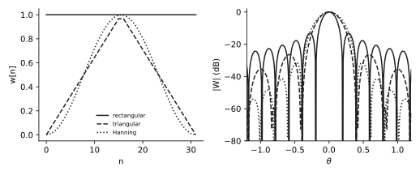
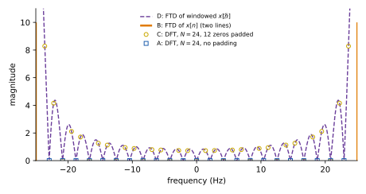
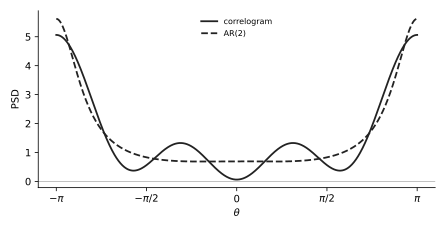
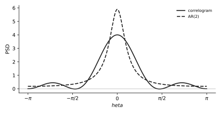

# U15 · Spectral estimation theory: methods, bias, variance, windows, energy, order, plots

Rank 3 · 8.6 points over 9 sittings1.4 to 1.5 p in each of the last three exams90 min

!!! need "Before this page"
    [U11](u11-correlogram.md) and [U12](u12-ar.md) (what a correlogram and an AR PSD are), [M4 geometric sums](maths.md#m4-geometric-sums), [M3 the $\cos^2$ identity](maths.md#m3-complex-exponentials-and-cosine-identities). This page is mostly facts; each fact is tied to the exam line that tests it.

## The idea in plain words

A PSD is an average over infinitely many realisations and infinitely long time. You have one finite record. Every method is a different compromise between two errors: **bias** (the estimate is systematically smeared or shifted) and **variance** (the estimate jumps around from record to record). Chopping the record into pieces and averaging lowers the variance but shortens each piece, which raises the bias. Windows trade a wider main lobe (worse resolution) for lower side lobes (less leakage). Every MC in this part is one of those two trade-offs in disguise.

!!! idea "The thing that confused me"
    "Consistent" sounded like a compliment. It is technical: an estimator is **consistent** when its variance goes to zero as the record length $N\to\infty$. The raw periodogram is **not** consistent: more data gives finer frequency detail but the wobble at each frequency stays as large as the spectrum itself. Averaging or smoothing is what buys consistency.

## 1 · The five non-parametric methods (Nov 2019 1c, Apr 2025 3c, Apr 2024 3a)

| Method | Basic idea | Bias | Variance |
|---|---|---|---|
| **Periodogram** | $\hat P = \frac1N\left\lvert\sum_{n=0}^{N-1}x[n]e^{-jn\theta}\right\rvert^2$: squared magnitude of the DFT of the record, divided by $N$ | asymptotically unbiased (bias → 0 as $N\to\infty$); for finite $N$ it is the FT of the **biased** autocorrelation estimate, i.e. the true PSD smeared by a triangular (Bartlett) window | **proportional to the square of the true PSD**; does not decrease with $N$: not consistent |
| **Correlogram** | FT of the estimated autocorrelation $\hat r[k]$ over the available lags | same as the periodogram when the biased $\hat r$ is used (they are the same estimator); with the unbiased $\hat r$ it can go negative | same as the periodogram; large |
| **Bartlett** (averaged periodogram) | cut the record into $K$ **non-overlapping** segments of length $M = N/K$, periodogram of each, average | bias **increases** (each segment is shorter → wider main lobe → poorer resolution) | reduced by a factor $1/K$ |
| **Welch / WOSA** (weighted overlapped segment averaging) | like Bartlett but segments **overlap** (typically 50 %) and each is windowed before its periodogram | similar to Bartlett (the window adds a little bias) | reduced roughly as $1/K$, but **not exactly** $1/K$ because overlapping segments are correlated; for a fixed $N$, overlap gives more segments than Bartlett, so a lower variance |
| **Blackman–Tukey** | window (smooth) the estimated autocorrelation with a lag window of length $M < N$, then FT | increases with a shorter lag window (smoothing) | decreases as $M/N$; consistent |

**Rows the exam likes.** "Consistent estimator": Bartlett, Welch, Blackman–Tukey (not the raw periodogram or correlogram). "FT of the autocorrelation": correlogram, Blackman–Tukey. "Averages multiple periodograms": Bartlett, Welch. "Allows overlap": Welch. "Variance proportional to the square of the true spectrum": periodogram (and raw correlogram). "Linear random signal model": parametric (AR, MA, ARMA).

!!! question "Your turn"
    You have $N = 1000$ samples and a very wobbly periodogram. A friend says "use zero padding to 4000 points, it will smooth it". Right or wrong, and what would you do instead?

    ???+ solution "Answer"
        Wrong: zero padding only interpolates the same wobbly curve on a finer grid; it changes neither bias nor variance. Average segments (Bartlett or Welch) or smooth the autocorrelation (Blackman–Tukey).

## 2 · Welch: how many segments, how much variance (Jun 2026 3b)

$$K = \frac{N - L}{L(1 - \text{overlap})} + 1,\qquad \frac{\operatorname{Var}(\hat P_{Welch})}{\operatorname{Var}(\hat P_{L})}\approx\frac1K\ \text{(independent segments)}$$

| Symbol | Meaning |
|---|---|
| $N$ | total record length |
| $L$ | segment length |
| overlap | fraction shared by consecutive segments (0.5 for 50 %) |
| $K$ | number of segments; the hop between segment starts is $L(1-\text{overlap})$ |

!!! exam "June 2026 resit · 3b · 0.5 p"
    You are given a data record of $N = 1000$ samples. You want to estimate the power spectral density using Welch's method to reduce the variance of your estimate. You choose a segment length of $L = 200$ samples and an overlap of 50%. **Provide only the final answer.** (1) How many segments $K$ will be averaged? (2) With the simplifying assumption that the segments are statistically independent, what is the ratio of the variance of your Welch estate to the variance of a single standard periodogram of length $L$?

???+ solution "Solution"
    Hop $= L(1 - 0.5) = 100$ samples. Starts at $0, 100, 200, \ldots$; the last segment must end by sample 1000, so its start is $800$: starts $0..800$ in steps of 100 → $9$ segments. Formula: $K = \frac{1000 - 200}{100} + 1 = 8 + 1 = 9$. Averaging $K$ independent estimates divides the variance by $K$: ratio $1/9\approx0.111$.

    !!! answer "Answer"
        $K = 9$; variance ratio $1/9$.

!!! question "Your turn"
    $N = 1200$, $L = 300$, no overlap (Bartlett). $K$? And with 50 % overlap?

    ???+ solution "Answer"
        Bartlett: $K = 1200/300 = 4$ (formula: $\frac{900}{300} + 1 = 4$). Welch 50 %: $\frac{900}{150} + 1 = 7$.

## 3 · Windows, resolution, leakage, zero padding (Nov 2022 3b, Jan 2020 1c, Jan 2022 3a)

<figure markdown>

<figcaption><b>How to read it.</b> Left: rectangular (solid), triangular (dashed), Hanning (dotted) windows in time. Right: their magnitude spectra in dB. The rectangular window has the narrowest main lobe (best resolution) but the highest side lobes (most leakage, first one at −13 dB). The tapered windows have wider main lobes and much lower side lobes.</figcaption>
</figure>

- **Main-lobe width** of the window's transform sets the **resolution**: two tones closer than the main lobe merge. Wider main lobe = worse resolution.
- **Side-lobe height** sets the **leakage**: power of a strong tone spilling into other frequencies. Higher side lobes = more leakage.
- For the **same length**, the rectangular window has the narrowest main lobe (best resolution) and the highest side lobes (worst leakage). Tapered windows (triangular, Hanning, Hamming) widen the main lobe and lower the side lobes.
- **Longer window** (more samples): main lobe narrower → better resolution. The *relative* side-lobe level does not change with length: leakage is a property of the window **shape**.
- **Zero padding** before the DFT: the DFT becomes a finer sampling of the same FTD (samples at $\theta = 2\pi k/L$ with $L$ the padded length). It interpolates the picture; it does **not** improve resolution (the main lobe is set by the number of real samples).

| Symbol | Meaning |
|---|---|
| FTD | Fourier transform for discrete-time signals: a continuous function of $\theta$ |
| DFT | the FTD sampled at $N$ (or $L$ after padding) equally spaced frequencies $\theta_k = 2\pi k/L$ |
| main lobe | the central bump of the window's transform |
| side lobes | the ripples beside it |

!!! exam "January 2022 resit · 3a · 0.3 p"
    $x[n] = 20\cos(2\pi\frac{f}{f_s}n)$, $f = 25$ Hz, $f_s = 50$ Hz, windowed with a rectangular window of length $N$ to obtain $\tilde x[n]$. The plots show: 1. the FTD of $x[n]$; 2. the FTD of $\tilde x[n]$; 3. the DFT of $\tilde x[n]$ for $N = 24$ with zero padding of $M = 12$ samples; 4. the DFT of $\tilde x[n]$ for $N = 24$ with no zero padding. Series: A (squares), B (solid line), C (circles), D (dashed). Which is the correct association? (a) 1B, 2D, 3A, 3C (b) 1B, 2D, 3C, 4A (c) 1C, 2A, 3D, 4B (d) 1D, 2B, 3C, 4A.

???+ solution "Solution"
    1. The FTD of an infinitely long cosine is two sharp lines at $\pm25$ Hz: the **solid line B** (two spikes). 2. Windowing smears each line into a sinc-shaped main lobe with side lobes: the **dashed continuous curve D**. 3 and 4 are DFTs: sets of **points**. With zero padding the points sample the dashed curve on a finer grid (36 points), so you see the side lobes: **circles C**. Without padding, $N = 24$ at $f_s = 50$ Hz gives bins every $50/24 = 2.083$ Hz, and $25$ Hz is exactly bin $12$: the samples fall on the peak and on the zeros of the sinc, so only the two peaks show: **squares A**. Association 1B, 2D, 3C, 4A: **(b)**.

    <figure markdown>
    
    <figcaption><b>How to read it.</b> Orange lines B: FTD of the infinite cosine. Purple dashed D: FTD of the 24-sample window, with side lobes. Yellow circles C: DFT with 12 zeros padded (36 points) sampling the dashed curve. Blue squares A: 24-point DFT, hitting only the peaks and the zeros.</figcaption>
    </figure>

## 4 · Energy signals and power signals (Apr 2025 3a, resit Q2 2023-24)

$$E = \int_{-\infty}^{\infty}|x(t)|^2dt\ \text{ or }\ \sum_n|x[n]|^2,\qquad P = \lim_{T\to\infty}\frac1T\int_{-T/2}^{T/2}|x(t)|^2dt\ \text{ or }\ \lim_{N\to\infty}\frac{1}{2N+1}\sum_{n=-N}^{N}|x[n]|^2$$

Finite $E$ (and so $P = 0$): **energy signal**. Infinite $E$ but finite nonzero $P$: **power signal**. Periodic signals are power signals. Decaying signals (exponentials, finite pulses) are energy signals.

!!! exam "April 2025 · 3a · 0.5 p"
    For each signal indicate whether it is an energy or a power signal, and provide its total energy and average power. **Provide only the final answer.** 1. $x(t) = A\sin(\omega t)$. 2. $x[n] = e^{-n}$ for $n\ge0$, $0$ elsewhere.

???+ solution "Solution"
    **1.** Periodic → power signal, $E = \infty$. Power: $\frac1T\int_{-T/2}^{T/2}A^2\sin^2(\omega t)dt$; use $\sin^2 u = \frac{1 - \cos 2u}{2}$: $= \frac{A^2}{T}\int\frac{1 - \cos(2\omega t)}{2}dt = \frac{A^2}{2T}\left[t\right]_{-T/2}^{T/2} - \frac{A^2}{2T}\left[\frac{\sin 2\omega t}{2\omega}\right]_{-T/2}^{T/2}$. First bracket $= T$, giving $\frac{A^2}{2}$; the second is bounded and divided by $T\to\infty$ gives $0$. $P = A^2/2$.

    **2.** $E = \sum_{n\ge0}|e^{-n}|^2 = \sum_{n\ge0}(e^{-2})^n = \frac{1}{1 - e^{-2}} = \frac{1}{1 - 0.1353} = \frac{1}{0.8647} = 1.1565$ ([M4](maths.md#m4-geometric-sums)). Finite → energy signal, $P = 0$.

    !!! answer "Answer"
        1: power signal, $E = \infty$, $P = A^2/2$. 2: energy signal, $E = 1/(1 - e^{-2}) \approx 1.16$, $P = 0$.

!!! question "Your turn (resit Q2 2023-24 table)"
    Classify and compute: (a) $x(t) = e^{-t}u(t)$; (b) $x(t) = \cos(t)u(t)$; (c) $x(t) = 5$ for $-2\le t\le2$, 0 elsewhere; (d) $x(t) = 5e^{-2|t|}$.

    ???+ solution "Answer"
        (a) $E = \int_0^\infty e^{-2t}dt = [-\frac12e^{-2t}]_0^\infty = 0 - (-\frac12) = \frac12$: energy. (b) $E = \infty$; $P = \lim\frac{1}{2T}\int_0^T\cos^2t\,dt = \lim\frac{1}{2T}\left(\frac T2 + \frac{\sin2T}{4}\right) = \frac14$: power. (c) $E = \int_{-2}^{2}25\,dt = 100$: energy. (d) $E = 2\int_0^\infty25e^{-4t}dt = 2\cdot\frac{25}{4} = \frac{25}{2}$: energy.

## 5 · AR model order (Jun 2026 3e · 0.75 p)

!!! exam "June 2026 resit · 3e"
    You fit an AR model of order $p$ to a record of length $N$. (1) If you judge the fit by the variance of the residual error, what happens as $p$ increases, and what is the primary risk of an excessively high $p$? (2) Name a model selection criterion from the course that prevents this and explain its mechanism. (3) Any arbitrary power spectrum (even one from an MA process with deep nulls) can be approximated with an AR model. What is required?

???+ solution "Solution"
    (1) The residual (prediction-error) variance $\hat\sigma_p^2$ **decreases monotonically** with $p$ (a bigger model always fits at least as well), so it can never tell you where to stop. The risk is **overfitting**: the model starts fitting the noise of this particular record, producing spurious peaks in the PSD and poor generalisation; also more parameters estimated from the same $N$ samples means larger variance of each.

    (2) Akaike's information criterion $\text{AIC}(p) = N\ln\hat\sigma_p^2 + 2p$, or the minimum description length $\text{MDL}(p) = N\ln\hat\sigma_p^2 + p\ln N$, or the final prediction error $\text{FPE}(p) = \hat\sigma_p^2\frac{N+p+1}{N-p-1}$. Mechanism: the first term rewards fit (it falls with $p$); the second is a **penalty that grows with $p$**; choose the $p$ that minimises the sum. The penalty stops the order from growing once the fit improvement is smaller than the cost of one more parameter.

    (3) A sufficiently **high order $p$**: by the Wold / Kolmogorov representation any regular spectrum can be written as an AR($\infty$); a spectral null (an MA zero on the unit circle) needs many poles to approximate, so $p$ must grow as the required accuracy grows.

## 6 · Plot matching (Apr 2025 3g, Apr 2024 3f, Nov 2019 2)

!!! recipe "U15 · Which plot?"
    1. Evaluate every PSD you computed at $\theta = 0$ (all cosines $= 1$) and at $\theta = \pi$ (alternating signs). Add $\theta = \pi/2$ if the first two tie.
    2. Note which curves must coincide (an exact MA(1) fit equals the correlogram; AR(1) and MA(1) fitted to the same two lags are close).
    3. Note sign: a parametric PSD ($\sigma^2|H|^2$) is never negative; a correlogram can dip below zero.
    4. Pick the panel whose values at $0$ and $\pi$ match. Say the two numbers in your answer.

!!! exam "April 2025 · 3g · 0.25 p"
    Given the four plots, which option represents the correct PSDs found in 3d, 3e and 3f? (a) Plot D (b) Plot C (c) Plot B (d) Plot A.

???+ solution "Solution"
    From U11–U13: $P_{corr}(0) = 1.125$, $P_{corr}(\pi) = 2.125$, peak $\approx2.46$ near $\pm0.61\pi$; $P_{AR}(0) = 1.556$, $P_{AR}(\pi) = 2.571$; $P_{MA}(0) = 1.5$, $P_{MA}(\pi) = 2.5$. We need a panel where AR and MA overlap with minimum $\approx1.5$ at 0 and maximum $\approx2.5$ at $\pm\pi$, and a correlogram slightly lower at 0 and at $\pi$ with bumps in between. Panel D's table: $P_{corr}$ $1.1$ at 0, $2.0$ at $\pi$, $2.3$ at $\pm\frac34\pi$; $P_{AR}, P_{MA}$ $1.5$ at 0, $2.4$ at $\pi$. Match: **plot D, option (a)**. (Panel A has a negative correlogram at 0; B has a correlogram at 0.8; C has everything negative at 0.)

    !!! answer "Answer"
        (a) Plot D.

!!! exam "April 2024 · 3f · 0.4 p"
    Which figure gives the correct plots of $P_{corr}$ (from 3d) and $P_{AR}$ (from 3e)? Options: (a) C (b) A (c) B (d) D.

???+ solution "Solution"
    $P_{corr}(0) = 0.0625\approx0$, $P_{corr}(\pi) = 5.06$; $P_{AR}(0) = 0.69$, $P_{AR}(\pi) = 5.6$. Panel B: $P_{corr}$ $0$ at 0 and $5$ at $\pm\pi$; $P_{AR}$ $0.65$ at 0 and $5.5$ at $\pm\pi$. **Plot B, option (c)**. (A has both $\approx7$ at $\pi$ and 2 at 0; C and D have negative values and peaks at 0.)

    <figure markdown>
    
    <figcaption><b>How to read it.</b> Solid: correlogram, almost zero at $\theta=0$, 5.06 at $\pm\pi$, small ripples. Dashed: AR(2) fit, 0.69 at 0, 5.6 at $\pm\pi$, smooth.</figcaption>
    </figure>

!!! exam "November 2019 · 2 (sketch)"
    Sketch the correlogram $1 + 1.4\cos\theta + \cos2\theta + 0.6\cos3\theta$ and the AR(2) estimate.

???+ solution "Solution"
    Correlogram: $4$ at 0, $0$ at $\pm\pi/2$ and $\pm\pi$. AR(2): $\frac{0.5098}{|1 - 0.6863 - 0.0196|^2} = \frac{0.5098}{0.0865} = 5.9$ at 0; at $\pi$: $\frac{0.5098}{|1 + 0.6863 - 0.0196|^2} = \frac{0.5098}{2.778} = 0.18$. Both low-pass, the AR peak taller and narrower.

    <figure markdown>
    
    <figcaption><b>How to read it.</b> Solid correlogram peaks at 4 with side bumps near $\pm2.2$; dashed AR(2) peaks at 5.9 and stays positive.</figcaption>
    </figure>

## 7 · Every past MC, with each option judged

!!! exam "June 2026 resit · 3a · 0.25 p"
    TRUE about the standard periodogram: (a) increasing the data window length decreases spectral leakage; (b) the periodogram is not a consistent estimator because its variance does not tend to zero as $N\to\infty$; (c) applying a data window (e.g. Hamming) improves the frequency resolution (main lobe width); (d) Bartlett's method decreases the variance by zero-padding.

???+ solution "Solution"
    (a) False: length narrows the main lobe (resolution), the relative side lobes (leakage) depend on the window shape. (b) **True**. (c) False: tapered windows *widen* the main lobe. (d) False: Bartlett averages segments; zero padding changes no variance.

!!! exam "April 2025 · 3b · 0.25 p"
    TRUE: (a) the problem of bias in the spectral estimate affects both deterministic and stochastic signals; (b) zero-padding before the DFT improves spectral resolution; (c) the raw periodogram has better bias but worse variance than the raw correlogram; (d) the window type affects both bias and variance of the raw periodogram.

???+ solution "Solution"
    (a) **True**: windowing (finite record) smears any spectrum, deterministic or random. (b) False: interpolation only. (c) False: they are the same estimator. (d) False per the key: the window shape governs the bias (smearing, leakage); the raw periodogram's variance is set by the random fluctuations of the record, proportional to $P^2$, whatever the window.

!!! exam "April 2025 · 3c · 0.5 p (table)"
    1. Non-overlapping segments, average periodograms → **Bartlett**. 2. $|$N-point DFT$|^2/N$ → **periodogram**. 3. $\sigma_i^2|(1+\sum b_qe^{-jq\theta})/(1+\sum a_pe^{-jp\theta})|^2$ → **ARMA modelling**. 4. $L$-point DFT of the windowed autocorrelation ($M<L$) → **Blackman–Tukey**. 5. Overlapping segments, average → **WOSA / Welch**.

!!! exam "April 2024 · 3a · 0.9 p (table, multiple answers)"
    1. Models the signal as a linear random signal model → **AR, MA, ARMA (parametric)**. 2. Segments with overlap → **Welch/WOSA**. 3. Consistent estimator → **Bartlett, Welch, Blackman–Tukey** (also the parametric methods). 4. FT of the autocorrelation → **correlogram, Blackman–Tukey**. 5. "Bias proportional to the square of the true spectrum" → the known property is the **variance** of the **periodogram/correlogram** $\propto P^2$; as printed, no method has such a bias, so answer "periodogram (correlogram)" and note the word should be variance. 6. Averages multiple periodograms → **Bartlett, Welch**.

!!! exam "November 2022 · 3a + 3b · 0.25 p each"
    **3a** (a) Bartlett with $K$ segments: variance $\propto1/K$, bias increases; (b) same for WOSA; (c) Bartlett: variance $1/K$, bias also decreases; (d) WOSA: variance $1/K$, bias decreases.

    **3b** (a) same length, triangular window gives higher resolution than rectangular; (b) main-lobe width determines resolution, side-lobe height determines leakage; (c) with a rectangular window leakage can be reduced by increasing the window length; (d) zero padding to length $L$ samples the FTD at steps $\theta = k2\pi/N$.

???+ solution "Solution"
    3a: **(a)**. Shorter segments → more bias, so (c) and (d) are out; WOSA's reduction is not exactly $1/K$, so (b) is out. 3b: **(b)**. (a) backwards (triangular has a wider main lobe); (c) length does not change relative side lobes; (d) the step after padding is $2\pi/L$, not $2\pi/N$.

!!! exam "January 2020 retake · 1b + 1c · 0.25 p each"
    **1b** Welch/WOSA: (1) no overlap, variance $\propto1/K$; (2) overlap allowed, variance lower than Bartlett's but not proportionally $1/K$; (3) no overlap, variance larger than Bartlett's; (4) overlap allowed, variance larger than Bartlett's but lower than the periodogram.

    **1c** Windowing: (1) higher side lobes → worse resolution; (2) higher side lobes → less leakage; (3) wider main lobe → worse resolution; (4) wider main lobe → more leakage.

???+ solution "Solution"
    1b: **(2)**. 1c: **(3)**; side lobes govern leakage, main lobe governs resolution; higher side lobes mean *more* leakage.

!!! exam "January 2019 · 1c · 0.5 p (two answers possible)"
    A. In Bartlett's method the bias increases as the segment length $M$ decreases. B. In Welch's periodogram with 50 % overlap the variance decreases as $1/K$. C. The Blackman–Tukey correlogram is a consistent estimator. D. In general, zero padding increases spectral resolution.

???+ solution "Solution"
    **A and C** true. B: not exactly $1/K$ (correlated segments). D: no.

!!! exam "November 2019 · 1b · 0.5 p (T/F)"
    A. Bayes' theorem is obtained from the total law of probability and the conditional probability. B. 50 % chance of rain here and 25 % on Mars, so 75 % that it rains here or on Mars. C. For discrete RVs the relative frequency tends to the PMF as the number of trials tends to infinity. D. For any RV the CDF at $-\infty$ and $\infty$ is 0 and 1. E. The Wiener FIR filter for 1-step linear prediction can be used for MA parametric spectral estimation.

???+ solution "Solution"
    Key: A removed (ambiguous; Bayes follows from the definition of conditional probability, total probability only rewrites the denominator), B **F** ($P(A\cup B) = P(A) + P(B) - P(A\cap B)$, and the events are not disjoint), C **T**, D **T**, E **F** (linear prediction gives **AR** coefficients).

## Where points get lost

!!! trap key "Where points get lost"
    | Wrong line | Right line |
    |---|---|
    | "Longer window → less leakage" | Longer window → **better resolution**; leakage depends on the window **shape**. |
    | "Hamming window → better resolution" | Tapered windows widen the main lobe: **worse** resolution, less leakage. |
    | "Zero padding improves resolution" | It only interpolates the DFT. |
    | "Averaging segments reduces bias and variance" | Variance down by $\approx1/K$, **bias up** (shorter segments). |
    | "Welch's variance is exactly $1/K$ of the periodogram's" | Overlapping segments are correlated: less than a $1/K$ reduction. |
    | "$K = N/L$" for Welch with overlap | $K = \frac{N-L}{L(1-\text{overlap})} + 1$: 9, not 5, for $N=1000$, $L=200$, 50 %. |
    | "A periodic signal has finite energy" | Periodic → infinite energy, finite power. |
    | "Residual variance picks the AR order" | It always decreases; use AIC/MDL/FPE with a penalty growing in $p$. |

## True or false (fresh wording)

| statement | T or F | why |
|---|---|---|
| Doubling the record length halves the variance of the raw periodogram. | False | Its variance stays proportional to $P^2$ whatever $N$: not consistent. |
| For a fixed $N$, Welch with 50 % overlap averages more segments than Bartlett with the same segment length. | True | Hop is $L/2$ instead of $L$: about twice as many segments. |
| Two sinusoids closer in frequency than the window's main-lobe width cannot be resolved, no matter how much zero padding is used. | True | Resolution is set by the window; padding interpolates. |
| Blackman–Tukey with a very short lag window has low variance and high bias. | True | Strong smoothing of the autocorrelation. |
| An energy signal has zero average power. | True | Finite energy divided by $T\to\infty$. |
| AIC adds a penalty $2p$ to $N\ln\hat\sigma_p^2$ so that the chosen order stops growing. | True | Section 5. |

**You can leave this page when you can:**

- [ ] fill the five-method table (idea, bias, variance) from memory.
- [ ] compute Welch's $K$ for any $N$, $L$, overlap.
- [ ] state which of main lobe / side lobes governs resolution / leakage, and what window length and zero padding do.
- [ ] classify a signal as energy or power and compute $E$ or $P$ (geometric sum, $\sin^2$ identity).
- [ ] explain AR order selection in three sentences.
- [ ] match PSD plots by their values at $0$ and $\pi$.

*[consistent]: an estimator whose variance tends to zero as the record length grows.
*[leakage]: power from one frequency appearing at other frequencies because of the window's side lobes.
*[resolution]: the smallest frequency separation at which two tones remain distinguishable; set by the main-lobe width.
*[periodogram]: |DFT|²/N of the record; the basic non-parametric PSD estimate.
*[WOSA]: weighted overlapped segment averaging, Welch's method.
