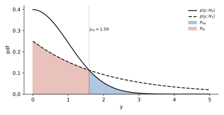
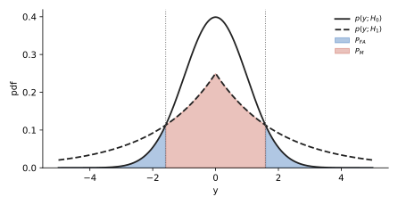
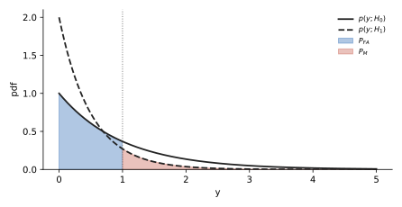
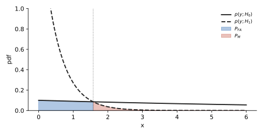
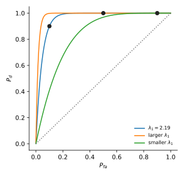
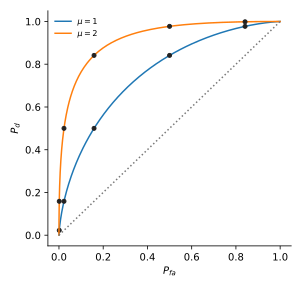

# U17 · P_FA, P_D, P_M: sketch them, shade them, compute them

Rank 1 · 9.7 points over 7 sittingsup to 2.5 p in one exam90 min

!!! need "Before this page"
    [M1 exponents and ln](maths.md#m1-exponents-and-logarithms), [M2 Gaussian and Q](maths.md#m2-the-gaussian-pdf-and-the-q-function), [M9 tail integrals](maths.md#m9-integrals-the-exam-hands-out-and-evaluating-at-0-and-infty), and [U16](u16-lrt.md) for where the threshold comes from (you can read U16 after this page; here the threshold is given or found by setting the two pdfs equal).

## The idea in plain words

Two stories could have produced the number you measured: "nothing there" ($H_0$) and "something there" ($H_1$). Each story has its own pdf. You draw a line (the **threshold**) on the axis and promise: on one side I say $H_1$, on the other I say $H_0$. Every probability in this unit is just the **area of one of the two curves on one side of that line**.

!!! idea "The thing that confused me"
    I kept asking "which curve and which side?". The fix: say the sentence. $P_{FA}$ = "the truth is $H_0$ (so use the $H_0$ curve) but I said $H_1$ (so the $H_1$ side)". $P_D$ = "truth $H_1$ (its curve), I said $H_1$ (its side)". $P_M$ = "truth $H_1$ (its curve), I said $H_0$ (the other side)". Curve = the truth, side = what you said.

## A tiny example with numbers

$H_0$: $p_0(y) = e^{-y}$, $H_1$: $p_1(y) = 2e^{-2y}$, both for $y\ge0$. Threshold at $y=1$, and (as in Nov 2022) we say $H_1$ when $y < 1$ because the $H_1$ curve is the taller one near zero.

- $P_{FA}$ = $H_0$ curve, $H_1$ side ($y<1$): $\int_0^1 e^{-y}dy = [-e^{-y}]_0^1 = -e^{-1} - (-1) = 1 - 0.3679 = 0.6321$.
- $P_D$ = $H_1$ curve, $H_1$ side: $\int_0^1 2e^{-2y}dy = [-e^{-2y}]_0^1 = 1 - e^{-2} = 1 - 0.1353 = 0.8647$.
- $P_M = 1 - P_D = 0.1353$, which is also $\int_1^\infty 2e^{-2y}dy = e^{-2}$.

!!! question "Your turn"
    Same two pdfs, threshold moved to $y = 0.5$. Compute $P_{FA}$ and $P_D$ (4 decimals).

    ???+ solution "Answer"
        $P_{FA} = 1 - e^{-0.5} = 1 - 0.6065 = 0.3935$. $P_D = 1 - e^{-1} = 0.6321$. Both dropped: a smaller $H_1$ region means fewer false alarms *and* fewer detections. That trade-off is the whole of detection theory.

## The formulas, every symbol named

| Symbol | Meaning | How to get it |
|---|---|---|
| $p(y;H_0)$, $p(y;H_1)$ | pdf of the observation under each hypothesis | given in the question |
| $\gamma$ (or $\lambda$, $\eta$) | threshold on the **likelihood ratio** $L(y) = p(y;H_1)/p(y;H_0)$ | given; $\gamma = 1$ is the common choice |
| $\gamma'$, $y_{th}$, $x_{th}$ | threshold on the **observation axis** | solve $L(y) = \gamma$ for $y$ ([U16](u16-lrt.md)); for $\gamma=1$ it is where the two curves cross |
| $\mathcal X_1$ | the set of $y$ where you decide $H_1$ | the side of $y_{th}$ where $p(y;H_1) > \gamma\, p(y;H_0)$ |
| $P_{FA}$ | probability of false alarm (type I error, false positive) | $\int_{\mathcal X_1} p(y;H_0)\,dy$ |
| $P_D$ | probability of detection (true positive) | $\int_{\mathcal X_1} p(y;H_1)\,dy$ |
| $P_M$ | probability of miss (type II error, false negative) | $1 - P_D = \int_{\mathcal X_0} p(y;H_1)\,dy$ |
| ROC | curve of $P_D$ (vertical) against $P_{FA}$ (horizontal) as the threshold moves | compute a few $(P_{FA}, P_D)$ pairs and join them |

**Where they come from.** "Probability that $y$ lands in a set" is the area of the pdf over that set. Nothing deeper.

## What the exam asks, in its own words

| IF YOU SEE | It means |
|---|---|
| "sketch the likelihoods" / "roughly plot the PDFs" | draw both curves on one axis with 2 or 3 labelled points each (value at 0, where they cross, how fast they die) |
| "indicate $P_{FA}$ and $P_M$ in the plot" | shade: $P_{FA}$ = area under the $H_0$ curve on the $H_1$ side; $P_M$ = area under the $H_1$ curve on the $H_0$ side |
| "for a threshold $\gamma = 1$" | the threshold is on the likelihood ratio; on the axis it is the crossing point of the two curves |
| "pay special attention to the inequality" | check which side is the $H_1$ side (the exam has caught people deciding $H_1$ on the wrong side) |
| "for $P_{FA} = 0.1$ calculate the threshold" | write $P_{FA}$ as an integral with the unknown limit, set it equal to 0.1, solve for the limit ([M1](maths.md#m1-exponents-and-logarithms) for the $\ln$) |
| "use $Q(x) = \int_x^\infty\ldots$" / an erf table / band values | the Gaussian area has no closed form; the exam hands you the numbers ([M2](maths.md#m2-the-gaussian-pdf-and-the-q-function)) |
| "there is no need to provide exact numerical values" | leave $Q(1.59)$ as it is; still write the integral and its limits |
| "plot the ROC curve" | $P_D$ on the vertical axis, $P_{FA}$ on the horizontal; compute the pairs they ask, join, and remember $(0,0)$ and $(1,1)$ are always on it |

## Recipe

!!! recipe key "U17 · Threshold, regions, areas"
    1. **Write both pdfs** with their domain ($y\ge0$? all $y$? $|y|$?). Copy them from the question.
    2. **Find the threshold on the axis.** If $\gamma = 1$: set $p(y;H_1) = p(y;H_0)$ and solve for $y$ (take $\ln$ of both sides). If $\gamma \ne 1$: do [U16](u16-lrt.md). If the exam gives $y_{th}$ directly, skip.
    3. **Decide which side is $H_1$.** Pick any easy test point (often $y = 0$ or a large $y$) and see which curve is larger there. The side where the $H_1$ curve is on top (times $\gamma$) is the $H_1$ side. Write the sentence "decide $H_1$ when $y < y_{th}$" or "$y > y_{th}$".
    4. **Sketch.** Mark each curve's value at $y=0$, the crossing point from step 2, and shade $P_{FA}$ ($H_0$ curve, $H_1$ side) and $P_M$ ($H_1$ curve, $H_0$ side).
    5. **Write the integrals** with explicit limits: $P_{FA} = \int_{H_1\text{ side}} p(y;H_0)dy$, $P_D = \int_{H_1\text{ side}} p(y;H_1)dy$.
    6. **Evaluate.** Exponential: [M9](maths.md#m9-integrals-the-exam-hands-out-and-evaluating-at-0-and-infty). Gaussian: standardise and read $Q$ or erf ([M2](maths.md#m2-the-gaussian-pdf-and-the-q-function)). Two-sided region ($|y| > y_{th}$): double the one-sided tail.
    7. **Sanity check.** Both numbers are between 0 and 1, and $P_D > P_{FA}$ (if not, you shaded the wrong side).
    8. If asked for a threshold from a target $P_{FA}$: write the step-5 integral with unknown limit, set equal to the target, solve ([M1](maths.md#m1-exponents-and-logarithms)).

## Worked exam question, one step at a time

!!! exam "April 2024 · 4b · 1.5 p"
    Consider the hypothesis

    $$\mathcal{H}_0: p(y) = \frac{1}{\sqrt{2\pi}} e^{-\frac{y^2}{2}}$$

    $$\mathcal{H}_1: p(y) = \frac{1}{4} e^{-\frac{y}{2}}$$

    where $y > 0$.

    - Sketch the likelihoods.
    - For a threshold $\gamma = 1$, indicate the probability of false alarm and the probability of missed detection.
    - For a threshold $\gamma = 1$, calculate the probability of detection and the probability of false alarm. Use the expression $Q(x) = \int_x^{\infty} \frac{1}{\sqrt{2\pi}} e^{-\frac{u^2}{2}} du$ for the $Q$ function. There is no need to provide exact numerical values.

**Step 1 · Write both pdfs and their values at $y = 0$.** $p_0(y) = \frac{1}{\sqrt{2\pi}}e^{-y^2/2}$: at $y=0$ it is $\frac{1}{\sqrt{2\pi}} = 0.3989$, and it dies like a bell. $p_1(y) = \frac14 e^{-y/2}$: at $y=0$ it is $0.25$, and it dies slowly (at $y = 2$ it is still $0.25\cdot e^{-1} = 0.092$, while $p_0(2) = 0.3989\cdot e^{-2} = 0.054$).

**Now do step 2 yourself:** set $p_1(y) = p_0(y)$, take $\ln$ of both sides, and get a quadratic in $y$. Then solve it.

---

**Step 2 · Crossing point.** $\frac14 e^{-y/2} = \frac{1}{\sqrt{2\pi}}e^{-y^2/2}$. Divide both sides by $\frac14 e^{-y^2/2}$ (rule $e^a/e^b = e^{a-b}$): $e^{-y/2 + y^2/2} = \frac{4}{\sqrt{2\pi}} = \frac{4}{2.5066} = 1.5958$. Take $\ln$: $\frac{y^2}{2} - \frac y2 = \ln 1.5958 = 0.4674$. Multiply by 2: $y^2 - y - 0.9347 = 0$. Quadratic formula ([M8](maths.md#m8-argmax-set-the-derivative-to-zero-quadratics)): $y = \frac{1 \pm \sqrt{1 + 3.7388}}{2} = \frac{1\pm 2.1769}{2}$. Positive root: $y_{th} = 1.5884$.

**Now do step 3 yourself:** at $y = 0$, which curve is on top? So on which side of $1.5884$ do we decide $H_1$?

---

**Step 3 · Which side is $H_1$.** At $y=0$: $p_0 = 0.399 > p_1 = 0.25$, so near zero $H_0$ wins. The curves cross once at $1.5884$; beyond it the slow exponential is on top. **Decide $H_1$ when $y > 1.5884$.** Check with $y = 3$: $p_1 = 0.25e^{-1.5} = 0.0558$, $p_0 = 0.399e^{-4.5} = 0.0044$. Yes.

**Now do step 4 yourself:** describe the sketch and say which area is $P_{FA}$ and which is $P_M$.

---

**Step 4 · Sketch and shade.** Bell starting at $0.399$, falling to almost 0 by $y = 3$. Exponential starting at $0.25$, falling slowly, crossing the bell at $y \approx 1.59$. $P_{FA}$ = area under the **bell** to the **right** of $1.59$ (truth $H_0$, said $H_1$). $P_M$ = area under the **exponential** to the **left** of $1.59$ (truth $H_1$, said $H_0$).

<figure markdown>

<figcaption><b>How to read it.</b> Solid: $H_0$ bell. Dashed: $H_1$ exponential. Vertical line at $y_{th} = 1.59$. Blue area (bell, right of the line) is $P_{FA}$. Red area (exponential, left of the line) is $P_M$. $P_D$ is the rest of the exponential, right of the line.</figcaption>
</figure>

**Now do step 5 yourself:** write $P_{FA}$ and $P_D$ as integrals with explicit limits.

---

**Step 5 · Integrals.** $P_{FA} = \int_{1.5884}^{\infty}\frac{1}{\sqrt{2\pi}}e^{-y^2/2}dy = Q(1.5884)$ by the definition the exam gives. $P_D = \int_{1.5884}^{\infty}\frac14 e^{-y/2}dy$.

**Now do step 6 yourself:** evaluate the exponential integral exactly (antiderivative, upper limit, lower limit, subtract).

---

**Step 6 · Evaluate.** Antiderivative of $\frac14 e^{-y/2}$ is $\frac14\cdot\frac{e^{-y/2}}{-1/2} = -\frac12 e^{-y/2}$. Upper limit $\infty$: $0$. Lower limit: $-\frac12 e^{-1.5884/2} = -\frac12 e^{-0.7942} = -\frac12(0.4519) = -0.2260$. Subtract: $0 - (-0.2260) = 0.2260$. So $P_D = \frac12 e^{-0.7942} = 0.226$ and $P_M = \int_0^{1.5884}\frac14 e^{-y/2}dy = \frac12(1 - e^{-0.7942}) = 0.274$.

**Step 7 · Sanity.** $Q(1.5884) \approx 0.056$ (table: $Q(1.59) = 0.0559$). $P_D = 0.226 > P_{FA} = 0.056$. Fine.

!!! trap "The half-area issue in this question"
    As printed, each pdf on $y>0$ has area $\frac12$ (half a bell, half of $\frac12 e^{-y/2}$), so $P_D + P_M = \frac12$. The exam says numbers are not needed, so the integrals above are the full-mark answer. If you want proper probabilities, fold both onto $y>0$ (multiply by 2): $P_{FA} = 2Q(1.5884) = 0.1118$, $P_D = e^{-0.7942} = 0.4519$. Those are exactly the numbers of the January 2022 twin question below, which uses $|y|$.

!!! answer "Answer"
    Decide $H_1$ when $y > 1.5884$. $P_{FA} = \int_{1.5884}^\infty p(y;H_0)\,dy = Q(1.5884) \approx 0.056$. $P_D = \int_{1.5884}^\infty \frac14 e^{-y/2}dy = \frac12 e^{-0.7942} \approx 0.226$ (folded onto $y>0$: $0.112$ and $0.452$).

## Do it cold · 1

!!! exam "January 2022 resit · 4b + 4c · 0.7 + 1 p"
    Consider hypotheses: $\mathcal{H}_0: p_Y(y) = \frac{1}{\sqrt{2\pi}} e^{-\frac{y^2}{2}}$, $\mathcal{H}_1: p_Y(y) = \frac{1}{4} e^{-\frac{|y|}{2}}$.

    **4b** Provide a sketch for the two PDFs and indicate the probability of false alarm and missed detection for a likelihood test with $\gamma = 1$.

    **4c** Calculate the probability of detection and false alarm for $\gamma = 1$. Below you can find a table with selected values of the Q-function: $Q(1.51) = 0.0655$, $Q(1.52) = 0.0643$, $Q(1.53) = 0.0630$, $Q(1.54) = 0.0618$, $Q(1.55) = 0.0606$, $Q(1.56) = 0.0594$, $Q(1.57) = 0.0582$, $Q(1.58) = 0.0571$, $Q(1.59) = 0.0559$.

???+ solution "Solution"
    **What is asked.** Same curves as April 2024 but two-sided: both pdfs live on all of $y$, and the Laplacian uses $|y|$.

    **Step 1.** $p_0(0) = 0.399$, $p_1(0) = 0.25$. Both symmetric around 0.

    **Step 2 · crossing.** $\frac14 e^{-|y|/2} = \frac{1}{\sqrt{2\pi}}e^{-y^2/2}$. Same algebra as before with $|y|$ in place of $y$: $y^2 - |y| - 0.9347 = 0 \Rightarrow |y| = 1.5884$, so the curves cross at $y = \pm1.5884$.

    **Step 3 · side.** At $y=0$ the bell is on top ($H_0$). In the tails the Laplacian is on top. So decide $H_1$ when $|y| > 1.5884$: **two** regions, left tail and right tail.

    **Step 4 · sketch.** Bell (peak 0.399) and a tent-shaped curve (peak 0.25, straight-ish sides in log scale) crossing at $\pm1.59$. $P_{FA}$ = both tails of the bell beyond $\pm1.59$. $P_M$ = the tent between $-1.59$ and $1.59$.

    <figure markdown>
    
    <figcaption><b>How to read it.</b> Solid bell = $H_0$, dashed tent = $H_1$. Blue = $P_{FA}$ (bell tails). Red = $P_M$ (tent centre).</figcaption>
    </figure>

    **Step 5 · integrals.** $P_{FA} = \int_{-\infty}^{-1.5884}p_0 + \int_{1.5884}^{\infty}p_0 = 2Q(1.5884)$ by symmetry. $P_D = 2\int_{1.5884}^\infty \frac14 e^{-y/2}dy$.

    **Step 6 · evaluate.** $P_{FA} = 2\times0.0559 = 0.1118$ (table at 1.59). $P_D$: antiderivative $-\frac12 e^{-y/2}$; upper $0$, lower $-\frac12 e^{-0.7942} = -0.2260$; one tail $= 0.2260$; two tails $= 0.4519$. $P_M = 1 - 0.4519 = 0.5481$.

    !!! answer "Answer"
        Decide $H_1$ for $|y| > 1.5884$. $P_{FA} = 2Q(1.5884) = 0.1118$. $P_D = e^{-0.7942} = 0.4519$.

## Do it cold · 2

!!! exam "November 2022 · 4d + 4e · 0.25 + 0.5 p"
    For the case $N=1$ the hypothesis test becomes $|x_n| \underset{\mathcal{H}_1}{\overset{\mathcal{H}_0}{\gtrless}} \gamma'$, which can be simplified by considering a new random variable $Y = |X|$ with distributions $\mathcal{H}_0: p(y;\mathcal{H}_0) = e^{-y}$, $\mathcal{H}_1: p(y;\mathcal{H}_1) = 2e^{-2y}$. The likelihood ratio test is then given by $y \underset{\mathcal{H}_1}{\overset{\mathcal{H}_0}{\gtrless}} \gamma'$.

    **4d** Indicate the probability of false alarm $P_{FA}$ and the probability of miss $P_M$ for a threshold $\gamma' = 1$ in the plot. **Hint:** Pay special attention to the inequality in the decision criteria.

    **4e** For a $P_{FA} = 0.1$ calculate the threshold $\gamma'$. For the threshold you have found, calculate the probability of detection $P_D$.

???+ solution "Solution"
    **Read the inequality.** $y \overset{H_0}{\underset{H_1}{\gtrless}}\gamma'$ means: $y$ *greater* than $\gamma'$ decides $H_0$ (the top label), $y$ *smaller* decides $H_1$. So the $H_1$ side is $y < \gamma'$. That is the hint: the $H_1$ curve $2e^{-2y}$ is the tall one near zero.

    **4d.** $P_{FA}$ = area under $e^{-y}$ (the $H_0$ curve) for $0 \le y < 1$. $P_M$ = area under $2e^{-2y}$ (the $H_1$ curve) for $y > 1$.

    <figure markdown>
    
    <figcaption><b>How to read it.</b> Solid $e^{-y}$ starts at 1; dashed $2e^{-2y}$ starts at 2. Left of $y=1$ we say $H_1$. Blue = $P_{FA}$ (solid curve, left). Red = $P_M$ (dashed curve, right).</figcaption>
    </figure>

    **4e, threshold.** $P_{FA} = \int_0^{\gamma'}e^{-y}dy = [-e^{-y}]_0^{\gamma'} = -e^{-\gamma'} - (-1) = 1 - e^{-\gamma'}$. Set $= 0.1$: $e^{-\gamma'} = 0.9 \Rightarrow \gamma' = -\ln 0.9 = 0.1054$.

    **4e, detection.** $P_D = \int_0^{\gamma'}2e^{-2y}dy = [-e^{-2y}]_0^{\gamma'} = 1 - e^{-2\gamma'}$. With $e^{-\gamma'} = 0.9$: $e^{-2\gamma'} = (e^{-\gamma'})^2 = 0.81$. $P_D = 1 - 0.81 = 0.19$.

    !!! answer "Answer"
        $\gamma' = -\ln 0.9 = 0.1054$; $P_D = 0.19$. (Tiny, because the two curves overlap heavily and we demanded $P_{FA} = 0.1$.)

## Do it cold · 3

!!! exam "January 2020 retake · 5 · 2.5 p"
    Consider the binary hypothesis testing problem where the observed data $x[0], x[1], \dots, x[n]$ consists of independent identically distributed samples and follows the exponential PDFs $\mathcal{H}_0 : x[n] \sim \lambda_0 e^{-\lambda_0 x}$, $\mathcal{H}_1 : x[n] \sim \lambda_1 e^{-\lambda_1 x}$ where $x \geq 0$, $\lambda_1 > \lambda_0 > 0$.

    - (a) For a single sample of observed data, roughly plot the PDFs for $\lambda_1 = 2$ and $\lambda_0 = 0.1$. Calculate and mark the threshold $x_{th}$ for likelihood ratio $\mathcal{L}(x_{th}) = 1$. Write down the equations for calculating the probability of detection $P_d$ and the probability of false alarm $P_{fa}$ in terms of $\lambda_0$, $\lambda_1$ and $x_{th}$. [0.75 pt.] **Hint:** The cumulative distribution function for the exponential PDF is $P(x < x_{th}) = 1 - e^{-\lambda x}$. Design your binary hypothesis test such that $P_d > P_{fa}$.
    - (b) Given $\lambda_0 = 0.1$, find $\lambda_1$ that gives $P_d = 0.9$ when $P_{fa} = 0.1$. [0.5 pt.]
    - (c) Plot the ROC curve with $P_d$ on the vertical axis and $P_{fa}$ on the horizontal axis for the $\lambda_1$ value calculated in (b), by calculating the $P_d$ for $P_{fa} = 0.5$ and $P_{fa} = 0.9$ as reference points for the ROC curve. Roughly sketch (without calculating $P_d$ and $P_{fa}$) two more curves describing the cases where $\lambda_1$ is increased and $\lambda_1$ is decreased. [1.25 pt.]

???+ solution "Solution"
    **(a) pdfs.** $p_0(x) = 0.1e^{-0.1x}$: starts at $0.1$, almost flat. $p_1(x) = 2e^{-2x}$: starts at $2$, dies by $x\approx3$.

    **Threshold.** $L(x) = \frac{2e^{-2x}}{0.1e^{-0.1x}} = 20e^{-1.9x}$ ($e^{-2x}/e^{-0.1x} = e^{-1.9x}$). Set $= 1$: $e^{-1.9x} = \frac{1}{20} \Rightarrow -1.9x = \ln(1/20) = -\ln 20 = -2.9957 \Rightarrow x_{th} = 1.5767$.

    **Side.** $L(x) > 1$ when $e^{-1.9x} > 1/20$, i.e. for small $x$: decide $H_1$ when $x < x_{th}$ (the steep curve is on top near 0). This also makes $P_d > P_{fa}$ as the hint demands.

    **Equations.** $P_d = \int_0^{x_{th}}\lambda_1 e^{-\lambda_1 x}dx = 1 - e^{-\lambda_1 x_{th}}$, $P_{fa} = \int_0^{x_{th}}\lambda_0 e^{-\lambda_0 x}dx = 1 - e^{-\lambda_0 x_{th}}$ (the CDF from the hint). Numbers at $x_{th} = 1.5767$: $P_d = 1 - e^{-3.153} = 1 - 0.0427 = 0.957$, $P_{fa} = 1 - e^{-0.1577} = 1 - 0.854 = 0.146$.

    <figure markdown>
    
    <figcaption><b>How to read it.</b> Flat solid line = $H_0$ ($0.1e^{-0.1x}$). Steep dashed = $H_1$ ($2e^{-2x}$). They cross at $x_{th} = 1.58$. Left of it we decide $H_1$. Blue = $P_{fa}$, red = $P_M$.</figcaption>
    </figure>

    **(b).** $P_{fa} = 0.1$: $1 - e^{-0.1x_{th}} = 0.1 \Rightarrow e^{-0.1x_{th}} = 0.9 \Rightarrow x_{th} = \frac{-\ln 0.9}{0.1} = \frac{0.1054}{0.1} = 1.0536$. Then $P_d = 0.9$: $1 - e^{-\lambda_1\cdot1.0536} = 0.9 \Rightarrow e^{-1.0536\lambda_1} = 0.1 \Rightarrow \lambda_1 = \frac{-\ln 0.1}{1.0536} = \frac{2.3026}{1.0536} = 2.1855$.

    **(c).** $P_{fa} = 0.5$: $x_{th} = \frac{-\ln 0.5}{0.1} = \frac{0.6931}{0.1} = 6.931$; $P_d = 1 - e^{-2.1855\cdot6.931} = 1 - e^{-15.15} \approx 1.000$. $P_{fa} = 0.9$: $x_{th} = \frac{-\ln 0.1}{0.1} = 23.03$; $P_d = 1 - e^{-50.3} \approx 1$. ROC: points $(0,0)$, $(0.1, 0.9)$, $(0.5, 1)$, $(0.9, 1)$, $(1,1)$: a curve that shoots up then runs along the top. Larger $\lambda_1$ (curves more different) pushes the curve further into the top-left corner; smaller $\lambda_1$ (curves more alike) pulls it toward the diagonal $P_d = P_{fa}$.

    <figure markdown>
    
    <figcaption><b>How to read it.</b> Horizontal $P_{fa}$, vertical $P_d$. Middle curve is $\lambda_1 = 2.19$ through $(0.1, 0.9)$. Upper curve: larger $\lambda_1$. Lower curve: smaller $\lambda_1$. Diagonal = guessing.</figcaption>
    </figure>

    !!! answer "Answer"
        (a) $x_{th} = \ln 20/1.9 = 1.577$; decide $H_1$ for $x < x_{th}$; $P_d = 1 - e^{-\lambda_1 x_{th}}$, $P_{fa} = 1 - e^{-\lambda_0 x_{th}}$. (b) $x_{th} = 1.054$, $\lambda_1 = 2.19$. (c) $P_d \approx 1$ at both $P_{fa} = 0.5$ and $0.9$.

## Do it cold · 4 (Gaussian with band values)

!!! exam "November 2019 · 4a + 4b · 0.5 + 0.5 p"
    $\mathcal{H}_0 : x[n] \sim \mathcal{N}(0, \sigma_0^2)$, $\mathcal{H}_1 : x[n] \sim \mathcal{N}(0, \sigma_1^2)$ where $\sigma_1 > \sigma_0$.

    - (a) For a single sample of observed data, roughly plot the PDF's and mark the threshold for likelihood ratio $\mathcal{L}(x[n]) = 1$. Write down the equations for calculating the probability of detection $P_d$ and the probability of false alarm $P_{fa}$ in terms of $p(x[n]; \mathcal{H}_1)$ and $p(x[n]; \mathcal{H}_0)$.
    - (b) Calculate the probability of detection and the probability of false alarm when $\sigma_1 = 3\sigma_0$ and the likelihood ratio is chosen such that the threshold is $x_{th} = \sigma_1$. For the calculations, use the values given below for $x \sim \mathcal{N}(0, \sigma^2)$: $Pr(0 \leq x \leq \sigma) = 0.341$, $Pr(\sigma \leq x \leq 2\sigma) = 0.136$, $Pr(2\sigma \leq x \leq 3\sigma) = 0.021$.

???+ solution "Solution"
    **(a).** Two bells centred at 0; the $H_0$ one is narrow and tall, the $H_1$ one wide and low. They cross at $\pm x_{th}$. The wide one is on top in both tails, so decide $H_1$ when $|x| > x_{th}$. $P_d = \int_{-\infty}^{-x_{th}}p(x;H_1)dx + \int_{x_{th}}^{\infty}p(x;H_1)dx = 2\int_{x_{th}}^\infty p(x;H_1)dx$; $P_{fa} = 2\int_{x_{th}}^\infty p(x;H_0)dx$.

    **(b).** Threshold $x_{th} = \sigma_1 = 3\sigma_0$. $P_{fa}$: under $H_0$ the threshold is at $3\sigma_0$, i.e. three of its own standard deviations. One tail beyond $3\sigma$: $0.5 - 0.341 - 0.136 - 0.021 = 0.002$. Two tails: $P_{fa} = 0.004$. $P_d$: under $H_1$ the threshold is at $\sigma_1$, one of its own standard deviations. One tail: $0.5 - 0.341 = 0.159$. Two tails: $P_d = 0.318$.

    !!! answer "Answer"
        $P_d = 0.318$, $P_{fa} = 0.004$.

## Do it cold · 5 (erf table)

!!! exam "October 2021 · 4a · 1 p"
    $y[n] \sim \mathcal{N}(0, \sigma^2)$ if $\mathcal{H}_0$, $\mathcal{N}(\mu, \sigma^2)$ if $\mathcal{H}_1$, $\sigma^2 = 1$. Given the cumulative distribution function is evaluated as $p(y < y_{th}; \mu, \sigma) = 0.5\left(1 + \operatorname{erf}\left(\frac{y_{th} - \mu}{\sigma\sqrt{2}}\right)\right)$ and using the table for $\operatorname{erf}(x/\sqrt2)$: $x = -3, -2, -1, 0, 1, 2, 3 \to -0.997, -0.954, -0.683, 0, 0.683, 0.954, 0.997$. Calculate $P_d$ and $P_{fa}$ for the threshold values $y_{th}$ and means $\mu$ listed: $(y_{th},\mu) = (-1,1), (-1,2), (0,1), (0,2), (1,1), (1,2), (2,1), (2,2), (3,1), (3,2)$. Use the values to plot ROC curves.

???+ solution "Solution"
    **Side.** $\mu > 0$, so the $H_1$ bell sits to the right; decide $H_1$ when $y > y_{th}$. Then $P_{fa} = P(y > y_{th}; \mu=0) = 1 - 0.5(1 + \operatorname{erf}(y_{th}/\sqrt2)) = 0.5(1 - \operatorname{erf}(y_{th}/\sqrt2))$ and $P_d = 0.5(1 - \operatorname{erf}((y_{th}-\mu)/\sqrt2))$. Read the table at $y_{th}$ for $P_{fa}$ and at $y_{th} - \mu$ for $P_d$.

    | $y_{th}$ | $\mu$ | $y_{th}-\mu$ | $P_d$ | $P_{fa}$ |
    |---|---|---|---|---|
    | $-1$ | 1 | $-2$ | $0.5(1+0.954) = 0.977$ | $0.5(1+0.683) = 0.8415$ |
    | $-1$ | 2 | $-3$ | $0.5(1+0.997) = 0.9985$ | $0.8415$ |
    | 0 | 1 | $-1$ | $0.8415$ | $0.5$ |
    | 0 | 2 | $-2$ | $0.977$ | $0.5$ |
    | 1 | 1 | 0 | $0.5$ | $0.5(1-0.683) = 0.1585$ |
    | 1 | 2 | $-1$ | $0.8415$ | $0.1585$ |
    | 2 | 1 | 1 | $0.1585$ | $0.5(1-0.954) = 0.023$ |
    | 2 | 2 | 0 | $0.5$ | $0.023$ |
    | 3 | 1 | 2 | $0.023$ | $0.5(1-0.997) = 0.0015$ |
    | 3 | 2 | 1 | $0.1585$ | $0.0015$ |

    **ROC.** One curve per $\mu$: plot the $(P_{fa}, P_d)$ pairs; the $\mu = 2$ curve lies above the $\mu = 1$ curve (more separation, better detector).

    <figure markdown>
    
    <figcaption><b>How to read it.</b> Dots are the table rows. Upper curve $\mu = 2$, lower curve $\mu = 1$. Both start at $(1,1)$ for a very low threshold and end at $(0,0)$ for a very high one.</figcaption>
    </figure>

    !!! answer "Answer"
        Table above. The January 2019 version (3b) is the same computation with $(X, \mu_1, \sigma_1)$: $P_{fa} = 0.1585$ for $X=1$, $0.023$ for $X=2$; $P_d = 0.5, 0.977, 0.8415, 0.8415$ for the four rows (standardise with $\sigma_1$: $(1-3)/2 = -1$ gives $0.8415$).

## Where points get lost

!!! trap key "Where points get lost"
    | Wrong line | Right line |
    |---|---|
    | "$P_{FA}$ = area under $H_1$ curve beyond the threshold" | $P_{FA}$ uses the **$H_0$** curve (truth $H_0$) on the **$H_1$** side (your wrong decision). |
    | Shading the right of the threshold because "$H_1$ is always on the right" | The $H_1$ side is where $p(y;H_1) > \gamma\,p(y;H_0)$. Nov 2022 and Jan 2020 have it on the **left**. Test a point. |
    | $P_M = \int_{\text{threshold}}^{\infty}p(y;H_1)$ in a left-sided test | $P_M = 1 - P_D$ always; shade the $H_1$ curve on the $H_0$ side. |
    | Forgetting the second tail when the region is $\lvert y\rvert > y_{th}$ | Two tails: multiply the one-sided tail by 2 (Jan 2022, Nov 2019). |
    | $Q(1.59)$ read as the area to the left | $Q$ is the area to the **right**. Area to the left is $1 - Q$. |
    | $1 - e^{-2\gamma'}$ evaluated with a fresh number | $e^{-2\gamma'} = (e^{-\gamma'})^2 = 0.9^2 = 0.81$: reuse what you already have. |
    | Stopping at the integral when the exam says "calculate" | Antiderivative, upper limit, lower limit, subtraction, number. Four written lines. |
    | $P_D < P_{FA}$ and moving on | Impossible for a sensible test; you shaded the wrong side. |

## True or false (from real MC options)

| statement | T or F | why |
|---|---|---|
| A false alarm is deciding $H_1$ when $H_0$ is true (type I error). | True | Nov 2022 4a: cell "decide $H_1$, true $H_0$" = false positive / false alarm / type I. |
| A miss is deciding $H_0$ when $H_1$ is true (type II error). | True | Same table, cell "decide $H_0$, true $H_1$". |
| Using the CDF instead of the tail to compute $P_d$ puts the ROC curve in the lower triangle. | True | Oct 2021 1e: it computes $1 - P_d$. |
| Setting the $H_0$ variance too high is a reason for a ROC curve below the diagonal. | False | Oct 2021 1e: a bad detector approaches the diagonal from above; it never goes below. This is the option that *cannot* be the reason. |
| On the ROC, $P_d$ is on the vertical axis and $P_{fa}$ on the horizontal. | True | Stated in Oct 2021 1e and Jan 2020 5c. |

**You can leave this page when you can:**

- [ ] say the sentence "curve = the truth, side = what I said" and shade $P_{FA}$ and $P_M$ for any pair of pdfs.
- [ ] find the crossing point of two pdfs by taking $\ln$.
- [ ] evaluate $\int_0^{\gamma}\lambda e^{-\lambda y}dy$ and $\int_\gamma^\infty\lambda e^{-\lambda y}dy$ in one line each.
- [ ] turn "$P_{FA} = 0.1$" into a threshold and then into $P_D$.
- [ ] read $Q$, erf, or band values for a Gaussian tail, including the two-tailed case.

*[threshold]: the value on the axis that separates "decide H0" from "decide H1".
*[likelihood ratio]: p(y;H1)/p(y;H0): how much more likely the observation is under H1 than under H0.
*[ROC]: receiver operating characteristic: P_D against P_FA as the threshold sweeps.
